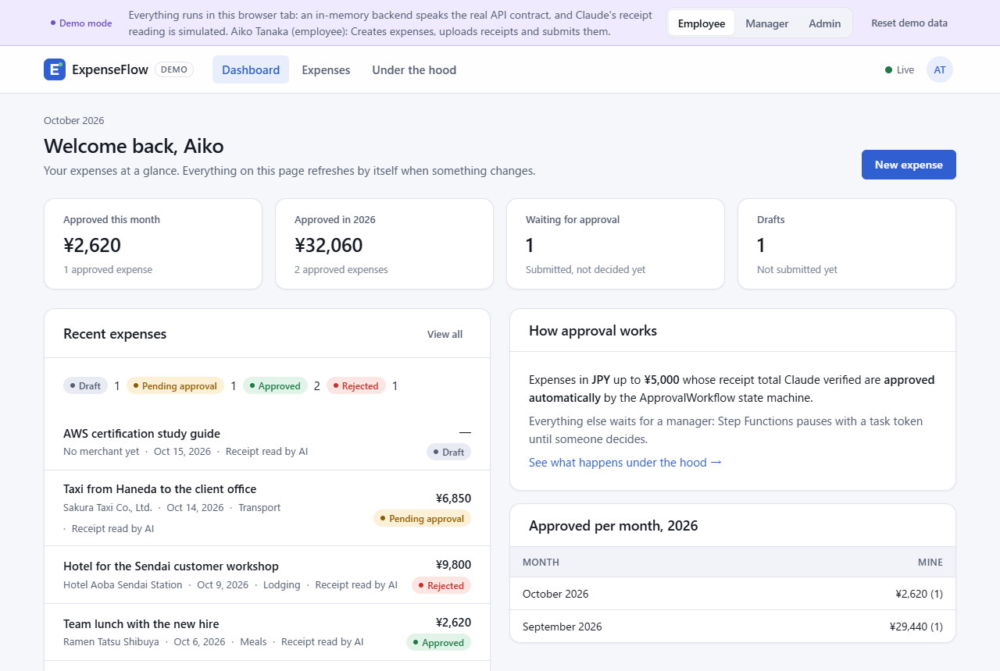
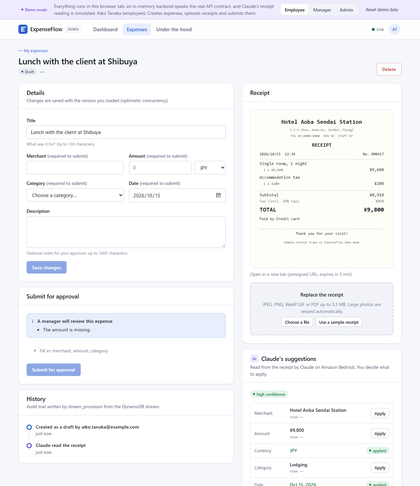
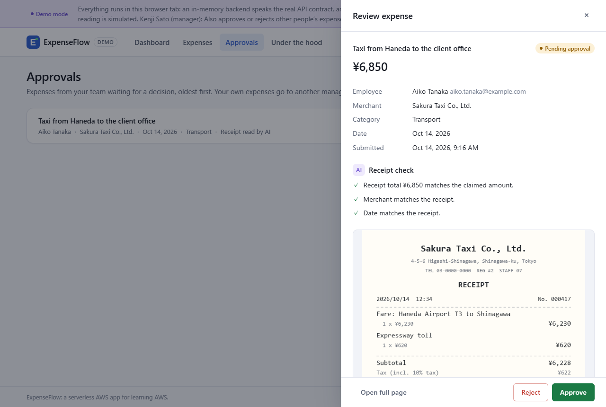
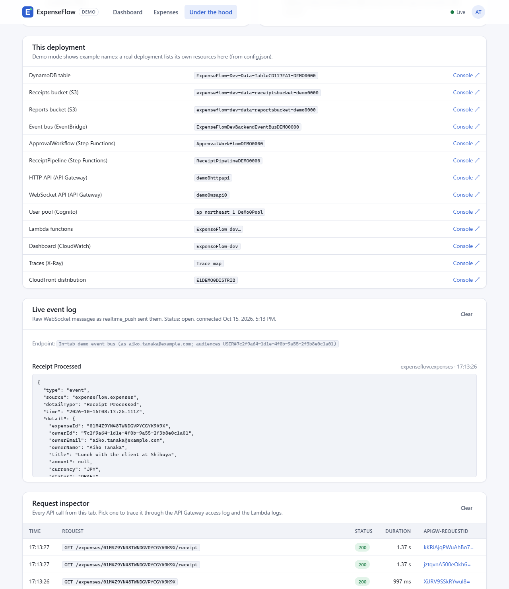
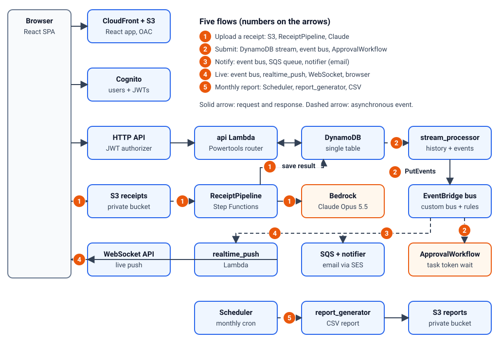

# ExpenseFlow

[](https://github.com/Temka0414/expenseflow/actions/workflows/ci.yml)
[](https://Temka0414.github.io/expenseflow/)
[](LICENSE)

**ExpenseFlow is a serverless expense-approval app on AWS, built to learn AWS by deploying something real.** Employees upload a receipt, Claude reads it, and a manager approves it. Small, verified expenses are approved automatically. Everything is infrastructure as code, tested, and explained in a reusable deployment playbook.

**[Try the live demo](https://Temka0414.github.io/expenseflow/)** (runs in your browser with a fake backend: no AWS, no sign-in).

<p>
  
  
</p>
<p>
  
  
</p>

## Architecture



## Features

- **Sign-up and roles.** Amazon Cognito. Everyone starts as an employee. Managers approve, admins also get reports.
- **Receipts with AI.** The browser uploads the file straight to S3 (presigned POST). A Step Functions pipeline asks **Claude on Amazon Bedrock** to read merchant, date, amount and category. The AI only *suggests*: the user decides.
- **Approval workflow.** Small, verified expenses are approved automatically. The rest wait for a manager, **for free**, using a Step Functions task token. The workflow escalates once, then expires.
- **Audit trail and events.** Every change is written to DynamoDB, streamed to EventBridge, and kept as history (the transactional outbox pattern).
- **Notifications.** EventBridge to SQS to SES, with a dead-letter queue and idempotency so that nobody gets the same email twice.
- **Live updates.** A WebSocket API pushes changes to open browsers.
- **Monthly reports.** EventBridge Scheduler runs a Lambda on the 1st of each month and stores the report in S3.
- **Production habits.** CloudWatch dashboard and alarms, X-Ray traces, cost budget, GitHub Actions CI/CD without stored AWS keys (OIDC), security rules checked by cdk-nag.

## Tech stack

| Area | Technology |
|---|---|
| Cloud | Amazon Cognito, API Gateway (HTTP and WebSocket), Lambda, DynamoDB, S3, CloudFront, Step Functions, EventBridge (bus and Scheduler), SQS, SES, Bedrock, CloudWatch, X-Ray, IAM, Budgets |
| Infrastructure | AWS CDK (Python), cdk-nag |
| Backend | Python 3.13, Powertools for AWS Lambda, pydantic |
| Frontend | React, TypeScript, Vite, Amplify UI |
| Tests | pytest and moto (AWS faked in memory), vitest, CDK assertions |
| CI/CD | GitHub Actions, OIDC |

## Run the demo locally (no AWS)

Needs Node.js 22.22 or newer.

```powershell
cd frontend
npm ci
npm run dev:mock
```

Open <http://localhost:5173>. The bar at the top switches between an employee, a manager and an admin.

## Deploy to your AWS account

Follow **[docs/expenseflow/deploy.md](docs/expenseflow/deploy.md)**. It starts from an empty Windows PC and ends with a working app, and it says which part of the [playbook](docs/playbook/00-overview.md) each step comes from.

Short version: install the tools, `aws login`, `cdk bootstrap`, then:

```powershell
.\scripts\deploy.ps1
```

## Learn

Start with **[docs/README.md](docs/README.md)**. It has the course map:

- the [**playbook**](docs/playbook/00-overview.md): ten phases that work for every AWS app,
- the [**patterns**](docs/patterns/01-cognito-auth.md): one page per AWS building block, with exercises,
- the [**portfolio guide**](docs/portfolio/github.md): GitHub workflow, demo, article.

## Repository layout

| Folder | Contents |
|---|---|
| `infra/` | AWS CDK app (Python): stacks, constructs, tests |
| `backend/` | Lambda code (Python), shared library, tests |
| `frontend/` | React app, with a demo mode that needs no AWS |
| `scripts/` | Deploy script, smoke test, Bedrock check, helper tools |
| `samples/` | A sample receipt used by the smoke test |
| `docs/` | Playbook, patterns, deploy guide, portfolio guide, diagrams |
| `.github/` | CI, deploy and GitHub Pages workflows, issue and PR templates |

## Cost

Estimates, not measurements. A lightly used `dev` stage costs cents to a few USD per month, because everything bills per use. **Reading one receipt with Claude Opus 5.5 costs roughly USD 0.02 to 0.06.** Set a budget alert before you deploy ([playbook phase 1](docs/playbook/01-account-guardrails.md)), and remove everything with `npx cdk destroy --all` when you are done ([phase 10](docs/playbook/10-teardown-prod.md)).

## What I learned

<!--
Fill this in with your own words after a few lessons. Keep it short and concrete.
Template:
- One thing about AWS that surprised me: ...
- The hardest bug and how I found it: ...
- What I would do differently: ...
- What I want to learn next: ...
-->

*(Your notes go here. See [LEARNING_LOG.md](LEARNING_LOG.md) for the raw material.)*

## How this was built

*(Write one honest paragraph: which parts you wrote, which parts an AI assistant helped with, and what you did to understand and verify them.)*

## License

[MIT](LICENSE) © 2026 Temuulen
