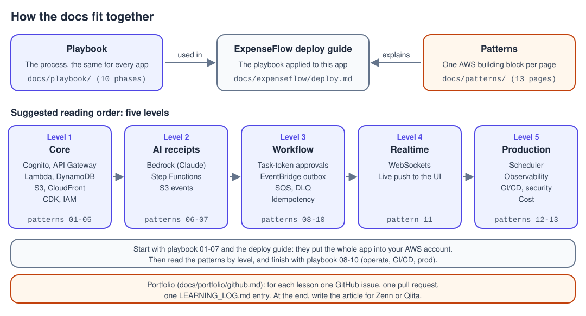

# ExpenseFlow docs: learn AWS by deploying a real app

These docs have two jobs.

1. **A reusable playbook.** The same ten phases work for *every* app you deploy on AWS: first set up the account, then install the tools, then sign in, and so on.
2. **A worked example.** ExpenseFlow, a serverless expense-approval app, shows each step with real commands and real code.

## The four parts

| Part | What is in it | Open it when |
|---|---|---|
| [Playbook](playbook/00-overview.md) | The 10 phases, each with exact steps, a check, common errors and a checklist for the next project | You start any AWS project |
| [ExpenseFlow deploy guide](expenseflow/deploy.md) | The playbook applied to this app, step by step in PowerShell | You want ExpenseFlow running in your own account |
| [Patterns](patterns/01-cognito-auth.md) | One page per AWS building block: the problem, the pattern, where it is in the code, a hands-on exercise, a break-and-fix, and a challenge | You want to understand *why* a service is used |
| [Portfolio guide](portfolio/github.md) | GitHub workflow, live demo, screenshots, README, article outline | You want to show the work to others |

## Suggested order

**Step A: get it running (about one weekend).**

1. Read the [playbook overview](playbook/00-overview.md).
2. Follow playbook phases [1](playbook/01-account-guardrails.md) to [7](playbook/07-verify.md) together with the [ExpenseFlow deploy guide](expenseflow/deploy.md). At the end the whole app runs in your account.

**Step B: learn by levels.** The app is already complete, so the levels are a *reading order*. Read the patterns of one level, find the code, do the hands-on exercise, and then the challenge as one pull request.

| Level | Theme | Patterns |
|---|---|---|
| 1. Core | Sign-in, an API, data, files, hosting, infrastructure as code, IAM | [01 Cognito auth](patterns/01-cognito-auth.md), [02 API Gateway + Lambda](patterns/02-api-gateway-lambda.md), [03 DynamoDB single table](patterns/03-dynamodb-single-table.md), [04 S3 presigned uploads](patterns/04-s3-presigned-uploads.md), [05 CloudFront SPA hosting](patterns/05-cloudfront-spa-hosting.md). CDK and IAM: playbook [phase 4](playbook/04-iac-bootstrap.md) and [phase 5](playbook/05-build-test-locally.md) |
| 2. AI receipts | Claude on Bedrock, a Step Functions pipeline, S3 events | [06 Bedrock AI extraction](patterns/06-bedrock-ai-extraction.md), [07 Step Functions pipeline](patterns/07-step-functions-pipeline.md) |
| 3. Workflow | Waiting for a human, events, queues, duplicates | [08 Task-token approvals](patterns/08-task-token-approvals.md), [09 EventBridge outbox](patterns/09-eventbridge-outbox.md), [10 SQS, DLQ, idempotency](patterns/10-sqs-dlq-idempotency.md) |
| 4. Realtime | Push updates to the browser | [11 WebSockets](patterns/11-websockets.md) |
| 5. Production | Scheduled jobs, observability, CI/CD, security, cost | [12 Scheduler jobs](patterns/12-scheduler-jobs.md), [13 Observability](patterns/13-observability.md), then playbook [08 operate](playbook/08-operate.md), [09 CI/CD](playbook/09-cicd.md), [10 teardown and prod](playbook/10-teardown-prod.md) |

**Step C: build your portfolio.** Follow the [portfolio guide](portfolio/github.md): one GitHub issue, one pull request and one [LEARNING_LOG.md](../LEARNING_LOG.md) entry per lesson. Finish with an article.

## Your next project

Open the [playbook overview](playbook/00-overview.md) and use its checklist. The commands change a little, the ten phases do not.

## Honest limits

- Nothing was deployed to a real AWS account from the machine that wrote these docs. The code has automated tests and a real `cdk synth` with cdk-nag. The AWS console steps come from AWS documentation. Your first deployment is the first real test.
- AWS console screenshots cannot be produced here. The docs give the exact click path and an HTML comment such as `<!-- screenshot: CloudFormation > Stacks > ... -->` where you can add your own.
- Prices and plan rules are estimates from the time of writing. Check the AWS pricing pages and your bill.

## Images

| Image | Where it is used |
|---|---|
| [course-map.svg](images/course-map.svg) | this page |
| [playbook-phases.svg](images/playbook-phases.svg) | [playbook overview](playbook/00-overview.md) |
| [architecture.svg](images/architecture.svg) | [root README](../README.md), [deploy guide](expenseflow/deploy.md) |
| `images/patterns/*.svg` | one diagram per [pattern](patterns/01-cognito-auth.md) |
| `images/screenshots/*.png` | [root README](../README.md), demo mode screenshots |
