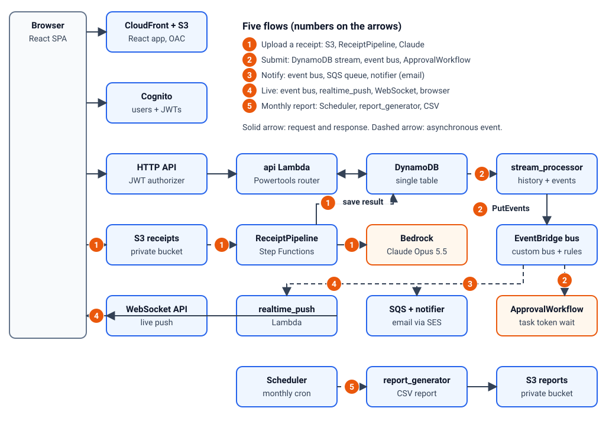

# Deploy ExpenseFlow to your AWS account

This is the [playbook](../playbook/00-overview.md) applied to ExpenseFlow, from an empty Windows PC to a working app, in PowerShell. Each part says which playbook phase it comes from. If a step is unclear, open that phase for the explanation.



**Honest status:** the code has automated tests (backend, infrastructure, frontend), and the infrastructure is synthesized with the real AWS CDK and checked by cdk-nag. **It has not been deployed to a real AWS account from the machine that wrote these docs.** You are the first real deployment. If a step fails in a way the page does not explain, note the exact message in [LEARNING_LOG.md](../../LEARNING_LOG.md) and fix this page in a pull request.

## 1. What you need first (playbook phases 1 to 3)

Do these once. Skip the ones you already have.

| Need | Playbook | Quick check |
|---|---|---|
| An AWS account with root MFA and a budget alert | [Phase 1](../playbook/01-account-guardrails.md) | Budgets lists your budget |
| Git, Python 3.13, Node 22.22+, AWS CLI 2.32+ | [Phase 2](../playbook/02-workstation-tools.md) | `git --version; python --version; node --version; aws --version` |
| An admin identity and a signed-in profile | [Phase 3](../playbook/03-identity-credentials.md) | `aws sts get-caller-identity` |

Plan note: AI receipt reading uses Claude on Amazon Bedrock. Bedrock is billed through AWS Marketplace. We could not verify that the Free plan allows it, so plan on the **Paid plan** for AI. Without it, deploy with `-c extractionModelId=none` (see step 12).

Set your terminal (every new window):

```powershell
$env:AWS_PROFILE = 'expenseflow'
$env:AWS_REGION  = 'ap-northeast-1'
$account = aws sts get-caller-identity --query Account --output text
"$account in $env:AWS_REGION"
```

Check the account number and Region it prints. Use another Region if your account is tied to one (see phase 1). The code adapts: it derives the right Bedrock inference-profile prefix (`jp.`, `au.`, `us.`, `eu.` or `global.`) from the Region.

## 2. Get the code and install it (phase 5)

```powershell
cd C:\src
git clone https://github.com/Temka0414/expenseflow.git
cd expenseflow

python -m venv .venv
.\.venv\Scripts\Activate.ps1
python -m pip install --upgrade pip
pip install -r backend/requirements-dev.txt -r infra/requirements-dev.txt
pip install "botocore[crt]"

cd frontend; npm ci; cd ..
cd infra;    npm ci; cd ..
```

Notes:

- Keep the **virtual environment activated** from now on. The CDK starts the app with plain `python app.py`.
- `botocore[crt]` is only needed because `aws login` profiles need it in the Python scripts.
- Short path: Windows MAX_PATH. See [phase 2](../playbook/02-workstation-tools.md), step 4.

## 3. Run the tests (phase 5)

```powershell
cd backend;  pytest -q; cd ..
pytest -q scripts/tests
cd infra;    pytest -q; cd ..
cd frontend; npm run lint; npm test; cd ..
```

All green? Continue. These tests use faked AWS and need no credentials.

Optional, to see the app first without AWS:

```powershell
cd frontend; npm run dev:mock
```

Open <http://localhost:5173>. Stop with Ctrl+C.

## 4. Bootstrap the account and Region (phase 4)

Once per account and Region:

```powershell
cd infra
npx cdk bootstrap "aws://$account/$env:AWS_REGION"
cd ..
```

Check: `aws cloudformation describe-stacks --stack-name CDKToolkit --query "Stacks[0].StackStatus" --output text` prints `CREATE_COMPLETE`.

## 5. Check Bedrock access (AI only)

```powershell
python scripts\check_bedrock.py
```

Why this exists: the **first** call to an Anthropic model in an account subscribes the account through AWS Marketplace. That needs permissions (`aws-marketplace:Subscribe` and related) that the receipt Lambda deliberately does **not** have, following least privilege. So you, the admin, make the first call here, with the exact client code the Lambda uses.

- It sends one tiny request to the primary model (Claude Opus 5.5) and to the refusal fallback model (Claude Opus 4.8). Cost: a fraction of a US cent each.
- It runs with your **admin credentials**.
- The first call can take a few minutes while AWS sets up the subscription. A payment method must be on file.
- If you changed the Region or the models with `-c bedrockRegion=...`, `-c extractionModelId=...` or `-c extractionFallbackModelId=...`, pass the same values: `--region`, `--model`, `--fallback-model` (`none` skips the fallback).

If it fails, the script explains why. If you do not want AI, skip this step and use `-c extractionModelId=none`.

## 6. Deploy (phase 6)

```powershell
.\scripts\deploy.ps1
```

The script checks your tools and identity, builds the frontend, then runs `npx cdk deploy --all` in `infra`. The CDK **asks for confirmation** before it applies IAM or security changes. Read the table, then answer `y`.

The first deployment takes several minutes (CloudFront is the slowest part). It creates five stacks: `ExpenseFlow-Dev-Edge`, `-Data`, `-Auth`, `-Backend` and `-Frontend`.

Manual equivalent, if you want to see each part:

```powershell
cd frontend; npm ci; npm run build; cd ..
cd infra;    npm ci; npx cdk deploy --all
```

Extra arguments (context flags, see step 11) go straight to `cdk deploy`: `.\scripts\deploy.ps1 -c alarmEmail=you@example.com`.

Good to know:

- The Backend stack sets the API Gateway **account-level CloudWatch Logs role** (needed for WebSocket logging). If your account already had one, it is replaced by this role. Other APIs in that account and Region keep logging.
- The deploy ends with next-step hints. Use them.

## 7. Read the outputs (phase 6)

```powershell
aws cloudformation describe-stacks --stack-name ExpenseFlow-Dev-Edge --query "Stacks[0].Outputs" --output table
```

Console: **CloudFormation > Stacks > ExpenseFlow-Dev-Edge > Outputs**.

<!-- screenshot: CloudFormation > Stacks > ExpenseFlow-Dev-Edge > Outputs -->

`SiteUrl` is the address of your app, like `https://d111111abcdef8.cloudfront.net`. Open it. You should see the ExpenseFlow sign-in page.

Other outputs: `ExpenseFlow-Dev-Auth` (`UserPoolId`, `UserPoolClientId`), `ExpenseFlow-Dev-Backend` (`ApiUrl`, `WebSocketUrl`, `DashboardName`, the two state machine ARNs), `ExpenseFlow-Dev-Data` (`TableName`, `ReceiptsBucketName`, `ReportsBucketName`). The scripts read them for you.

## 8. Sign up in the site

1. Open the `SiteUrl`. Choose **Create Account**.
2. Enter your full name, your email address and a password. Rules: at least 12 characters, with upper and lower case letters, a digit and a symbol.
3. Cognito emails you a **verification code**. Enter it. Cognito's built-in email sender is limited to about 50 messages per day, plenty for learning. Check the spam folder.
4. Sign in. A new user joins the **employees** group automatically (the `post_confirmation` Lambda does that).

Employees can create expenses, upload receipts and submit them. Managers can approve. Admins can also create reports.

## 9. Make yourself a manager or admin

Use the email address you signed up with:

```powershell
python scripts\add_user_to_group.py --email you@example.com --group managers
python scripts\add_user_to_group.py --email you@example.com --group admins
```

Then **sign out and sign in again** in the browser. Your groups are inside the sign-in token, and the token only updates when you sign in again (or after about an hour). The **Approvals** and **Reports** menu entries appear.

Try the full flow:

1. **New expense**, then upload a receipt image or PDF. The AI step reads merchant, date, amount and category. You decide: it only *suggests*.
2. **Submit.** An expense of **5000 or less** in the default currency (JPY), whose total the AI verified, is **approved automatically**. Anything else waits for a manager.
3. **You cannot approve your own expense** (the API refuses it). To try the manager side, sign up a second user (another email address, for example `you+manager@example.com` if your mail provider supports it), add that user to `managers`, and approve from there.

Use the **Under the hood** menu entry in the app: it shows live what AWS service does each step.

## 10. Run the smoke test (phase 7)

```powershell
python scripts\smoke_test.py
```

It creates a temporary employee and manager, uploads `samples\sample-receipt.pdf`, waits for the AI extraction, submits, approves, and checks the audit history. It deletes the temporary users at the end, even when it fails. It sets the amount just above the auto-approval limit on purpose, so a manager decision is needed.

It prints `SMOKE TEST PASSED` and exits with code 0 when everything works. With AI switched off it also works: the extraction step ends as `SKIPPED`.

If it fails, read [phase 7](../playbook/07-verify.md) for logs, traces and workflow executions.

## 11. Work on the frontend against your real backend

```powershell
python scripts\write_frontend_config.py
cd frontend
npm run dev
```

`write_frontend_config.py` reads the stack outputs and writes `frontend\public\config.json` (Git ignores it). Open <http://localhost:5173> and sign in with your user. The API's CORS rule allows exactly this origin, and the port is fixed for that reason.

If you deployed with AI off, add `--no-extraction`. For another stage use `--stage prod`.

## 12. Optional settings (context flags)

Pass them to `deploy.ps1` as `-c name=value`. Invalid values fail right away with a message that names the flag.

| Flag | Default | What it does |
|---|---|---|
| `stage` | `dev` | Name of this copy. `prod` keeps its data on delete and adds protection ([phase 10](../playbook/10-teardown-prod.md)). |
| `alarmEmail` | none | Subscribes you to the alarm topic. **Click the confirmation link in the email.** |
| `senderEmail` | none | Sender address for approval emails. AWS emails a verification link to it after the deploy. SES starts in the **sandbox**: it only sends to verified addresses. Without it the app sends no emails (the notifier only logs what it would send). |
| `budgetEmail` | none | Deploys the account-wide `ExpenseFlow-Budget` stack (alerts at 80 % actual and 100 % forecast). |
| `monthlyBudgetUsd` | `10` | The budget amount for `budgetEmail`. |
| `autoApproveLimit` | `5000` | Expenses up to this amount (in the default currency) with a verified receipt are approved without a manager. |
| `approvalTimeoutMinutes` | `4320` (3 days) | How long the workflow waits for a manager. It then escalates once and waits again. Allowed range: 1 to 20160. |
| `extractionModelId` | Claude Opus 5.5 for your Region | Use `none` to turn AI extraction off. Receipts are then stored and marked skipped. |
| `extractionFallbackModelId` | Claude Opus 4.8 | Model used when the primary model refuses. `none` removes the fallback. |
| `bedrockRegion` | the stack's Region | Call Bedrock in another Region. |
| `defaultCurrency` | `JPY` | Currency of the auto-approval policy (for example `USD`). |
| `githubRepo` | none | Deploys the `ExpenseFlow-GitHubOidc` stack for [CI/CD](../playbook/09-cicd.md). |

Example:

```powershell
.\scripts\deploy.ps1 -c alarmEmail=you@example.com -c senderEmail=you@example.com -c autoApproveLimit=3000
```

The CDK does not remember flags between runs. Pass the same flags on **every** deploy, or they fall back to their defaults. Do not put them in `infra\cdk.json` instead: that file is public once you push, so an `alarmEmail` there publishes your address, and the GitHub deploy ([phase 9](../playbook/09-cicd.md)) passes its own flags.

## 13. What it costs

The numbers are estimates, not measurements.

- **Idle:** cents to a few USD per month. Everything bills per use. Alarms (beyond 10), log storage and X-Ray add small amounts.
- **AI:** roughly USD 0.02 to 0.06 per receipt with Claude Opus 5.5. This is the main cost. Switch it off with `-c extractionModelId=none`.
- **Early warning:** the budget alert from [phase 1](../playbook/01-account-guardrails.md). Look at **Cost Explorer** monthly ([phase 8](../playbook/08-operate.md)).

## 14. Update and tear down

Change code, then run `.\scripts\deploy.ps1` again. Run `cd infra; npx cdk diff` first to see what would change.

When you are done experimenting:

```powershell
cd infra
npx cdk destroy --all -c stage=dev
```

A `dev` stage deletes everything it created. Account-wide extras (budget, GitHub OIDC) and the CDK bootstrap stay until you remove them. Details: [phase 10](../playbook/10-teardown-prod.md).

## Problems

| Problem | Fix |
|---|---|
| `deploy.ps1`: "The python on PATH lacks the CDK libraries" | Activate the virtual environment and run `pip install -r infra\requirements.txt`. |
| Deploys to the wrong Region | `$env:AWS_REGION` was not set in this window. |
| `... uses assets, so the toolkit stack must be deployed` | Step 4 for this Region. |
| Stack `ROLLBACK_COMPLETE` | Read the stack's **Events** tab for the first `CREATE_FAILED`, delete the stack, fix, deploy again. |
| Site shows "config.json was not found" | The Frontend stack has not been deployed or the browser cached an old page. Run the deploy again and hard-refresh (Ctrl+F5). |
| Approvals menu is missing | Sign out and in again after `add_user_to_group.py`. |
| No emails | `senderEmail` was not set, or SES is still in the sandbox and the receiver is not verified. |
| Smoke test: extraction FAILED | Run `check_bedrock.py`, or deploy with `-c extractionModelId=none`. |
| `ENOTEMPTY ... jsii-kernel` when `cdk` exits | Harmless Windows noise. |

More errors per phase are in the [playbook](../playbook/00-overview.md). To understand *why* each service is used, read the [patterns](../patterns/01-cognito-auth.md).
