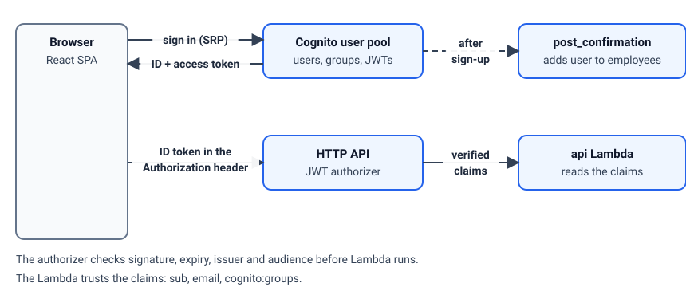

# Pattern 01: Sign-in and roles with Amazon Cognito

Services: Amazon Cognito user pool, API Gateway JWT authorizer, a Lambda trigger.

## Problem

Every request must say who the user is and what they may do. Storing passwords, sending confirmation e-mails, signing tokens and supporting MFA are security-critical jobs. A mistake there is a data breach. You want a managed service to do them.

## Pattern

A **user pool** is a managed user directory. It signs users up, checks passwords, and hands the browser signed **JWT** tokens. Every API call carries a token. API Gateway verifies the token before your code runs. Your code only reads the claims. Groups in the token become roles.



Key ideas:

- **ID token** carries identity claims (`sub`, `email`, `name`, `cognito:groups`). **Access token** is for calling APIs about the user. ExpenseFlow sends the ID token to the HTTP API and the access token to the WebSocket API.
- **SRP** (Secure Remote Password) signs in without sending the password to Cognito in clear text. The browser app is a *public client*: it cannot keep a secret, so the app client has none.
- Tokens are **stateless**. API Gateway checks signature, expiry, issuer and audience. It never calls Cognito per request.
- Groups are **copied into the token when it is issued**. A group change is visible only after the next sign-in or refresh.

## In ExpenseFlow

- [`auth_stack.py`](../../infra/expenseflow_infra/stacks/auth_stack.py)
  - `AuthStack._user_pool`: e-mail sign-in, 12-character password policy, optional TOTP MFA, Essentials plan.
  - `AuthStack._web_client`: SRP only, no OAuth flows, 1 hour ID and access tokens, 30 days refresh token, token revocation on sign-out.
  - Three groups with precedence: `admins`, `managers`, `employees`.
  - `AuthStack._post_confirmation_trigger`: shows why the IAM permission is a standalone `iam.Policy` (a grant on the pool would create a dependency cycle).
- [`post_confirmation.py`](../../backend/src/handlers/post_confirmation.py): puts every self-signed-up user into `employees`. It checks `triggerSource == "PostConfirmation_ConfirmSignUp"` because the trigger also fires after a password reset. Cognito waits at most 5 seconds for it, so it uses only the standard library and boto3.
- [`http_api.py`](../../infra/expenseflow_infra/constructs/http_api.py): `HttpUserPoolAuthorizer` on every route. This authorizer does not check `token_use`, so the ID token works.
- [`auth.py`](../../backend/src/expenseflow/auth.py): `caller_from_claims` builds a `Caller`. `parse_groups` handles the odd format API Gateway uses for arrays: `"[managers employees]"`.
- [`deps.py`](../../backend/src/handlers/api/deps.py): `CurrentCaller`, `require_approver`, `require_admin` turn groups into route rules.
- Browser: [`start.tsx`](../../frontend/src/aws/start.tsx) (`Amplify.configure`), [`session.ts`](../../frontend/src/aws/session.ts) (`idToken()`, `accessToken()`, refresh), [`AwsApp.tsx`](../../frontend/src/aws/AwsApp.tsx) (Amplify `Authenticator` screens).

## Same pattern in other industries

- **Hospital patient portal**: groups `patients`, `nurses`, `doctors`. A nurse's token lets the API list ward patients; a patient's token only its own record.
- **B2B SaaS**: groups per role (`tenant-admin`, `member`) plus a custom claim with the tenant id, so every query is scoped to one customer.
- **School learning platform**: `students`, `teachers`, `parents`. The sign-in service is the same, only the group rules differ.

## Hands-on

> These steps are written from the code and the AWS documentation. Nothing was deployed to a real AWS account from the machine that wrote this page. If a console label differs, trust the resource name.

Deploy first: [ExpenseFlow deploy guide](../expenseflow/deploy.md).

**Console**

1. Sign in to the AWS console in your Region (default `ap-northeast-1`).
2. Open **Amazon Cognito > User pools > `ExpenseFlow-dev-users`**.
3. Tab **Users**: your sign-up appears with status `Confirmed`.
4. Open the user: section **Group memberships** shows `employees` (added by the trigger).
5. Left menu **Groups**: three groups with their precedence numbers.
6. Left menu **Applications > App clients**, open the single app client: check that it has *no client secret* and that its authentication flows include `ALLOW_USER_SRP_AUTH`.

<!-- screenshot: Cognito > User pools > ExpenseFlow-dev-users > Users > (your user) > Group memberships -->
<!-- screenshot: Cognito > User pools > ExpenseFlow-dev-users > Applications > App clients > (the app client) -->

**CLI (PowerShell)**

1. Helper that reads a CloudFormation output (used on all pattern pages):

```powershell
$env:AWS_PROFILE = 'expenseflow'; $env:AWS_REGION = 'ap-northeast-1'
function Get-Output($Stack, $Key) {
  aws cloudformation describe-stacks --stack-name $Stack --query "Stacks[0].Outputs[?OutputKey=='$Key'].OutputValue" --output text
}
$site = Get-Output ExpenseFlow-Dev-Edge SiteUrl
$api  = Get-Output ExpenseFlow-Dev-Backend ApiUrl
```

2. Open `$site`, choose **Create account**, enter e-mail, name and password, then the code Cognito mails you. Cognito's default sender is limited to 50 e-mails per day.
3. Get an ID token for scripts. The app client allows `ADMIN_USER_PASSWORD_AUTH` for this (it needs your admin AWS credentials, so it is not usable from a browser). Use a lab password without commas:

```powershell
$pool   = Get-Output ExpenseFlow-Dev-Auth UserPoolId
$client = Get-Output ExpenseFlow-Dev-Auth UserPoolClientId
$env:ID_TOKEN = aws cognito-idp admin-initiate-auth --user-pool-id $pool --client-id $client `
  --auth-flow ADMIN_USER_PASSWORD_AUTH --auth-parameters "USERNAME=you@example.com,PASSWORD=<your password>" `
  --query "AuthenticationResult.IdToken" --output text
```

4. Read the token claims (a JWT is three Base64 parts; the middle one is the payload):

```powershell
$p = $env:ID_TOKEN.Split('.')[1].Replace('-','+').Replace('_','/')
$p = $p.PadRight($p.Length + (4 - $p.Length % 4) % 4, '=')
[Text.Encoding]::UTF8.GetString([Convert]::FromBase64String($p)) | ConvertFrom-Json | Format-List sub, email, name, 'cognito:groups', token_use, exp
```

5. Call the API with and without the token:

```powershell
curl.exe -i "$api/me"                                         # 401 from API Gateway, Lambda is not invoked
curl.exe -s -H "Authorization: Bearer $env:ID_TOKEN" "$api/me"  # your userId, email, groups
```

## Break it and fix it

**Experiment: a group change does not reach a token you already hold.**

1. Check that you are not a manager yet: `curl.exe -i -H "Authorization: Bearer $env:ID_TOKEN" "$api/approvals"` returns **403** `only managers and admins can do this`.
2. Add yourself to the group (venv active, same profile): `python scripts/add_user_to_group.py --email you@example.com --group managers`. See [`add_user_to_group.py`](../../scripts/add_user_to_group.py).
3. Repeat the call with the **same** token. It is still 403, because the token still lists only `employees`.
4. Request a new token (step 3 above). The call now returns 200.

**What you learn**: the authorizer is fast because it is stateless, and the price is staleness. In the app, sign out and in (or let the token refresh) after a role change. For a password reset or "remove access now", short token lifetimes (1 hour here) limit the damage window.

## Your turn (one pull request)

Add a fourth group `auditors`: it may **read** every expense but not approve anything.

- Add the group and its precedence in `auth_stack.py`; add the name to `settings.GROUPS`.
- Add `Caller.is_auditor` and let `ensure_can_view` in `auth.py` accept it (keep `can_approve` unchanged).
- Extend the tests in `backend/tests/test_lib_auth.py` and `infra/tests/test_auth_stack.py`.

Acceptance: an auditor can `GET /expenses/{id}` of any owner and gets 403 on `POST /approvals/{id}/decision`.

## Interview questions

<details>
<summary>Show questions and short answers</summary>

1. **What is the difference between an ID token and an access token?**
   The ID token says who the user is (profile claims). The access token authorizes calls and carries scopes and groups but no e-mail. ExpenseFlow's API needs `email` and `name`, so the HTTP API uses the ID token.
2. **Why does API Gateway not call Cognito for every request?**
   JWTs are signed. API Gateway verifies the signature with the pool's public keys, so no network call per request is needed. Revocation is therefore not instant.
3. **A user was removed from a group but can still approve. Why?**
   The group list is in the token and the token is valid until it expires. Wait for expiry, force a new sign-in, or keep lifetimes short.
4. **Why is the SPA a "public client" with no secret?**
   Anything shipped to a browser can be read, so a secret there is not a secret. SRP and short-lived tokens protect the flow instead.
5. **Why does `post_confirmation` use no layer and no Powertools?**
   Cognito allows 5 seconds for a trigger. The function should start as fast as possible and fail inside the budget.
6. **JWT authorizer or Lambda authorizer?**
   A JWT authorizer is built in, cheap and enough for standard OIDC tokens. A Lambda authorizer is needed for custom rules (API keys, extra database checks). ExpenseFlow uses a Lambda authorizer only on the WebSocket `$connect` route, see [pattern 11](11-websockets.md).

</details>

Next: [Pattern 02, API Gateway and Lambda](02-api-gateway-lambda.md).
