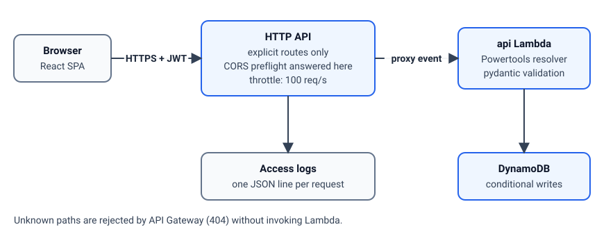

# Pattern 02: A JSON API with API Gateway and Lambda

Services: API Gateway HTTP API, AWS Lambda, Powertools for AWS Lambda (Python), CloudWatch Logs.

## Problem

The browser needs a JSON API. You do not want servers to patch or scale. You still need authentication, CORS, rate limits, input validation, error responses and logs. And the API must stay cheap when nobody uses it.

## Pattern

An **HTTP API** is the front door. It checks the token ([pattern 01](01-cognito-auth.md)), answers CORS preflight itself, applies throttling and writes access logs. Behind it, **one Lambda function** (a "Lambdalith") runs a router that dispatches `METHOD + path` to Python functions.



Decisions and trade-offs:

- **HTTP API, not REST API**: about 70% cheaper, lower latency, native JWT authorizer. You give up usage plans, API keys, request validation and WAF integration. ExpenseFlow needs none of them.
- **Explicit routes, no catch-all**: API Gateway rejects unknown paths with 404 and no Lambda cost. A `$default` route would send CORS preflight (`OPTIONS`, no token) to the authorizer, which rejects it, and the browser blocks every call.
- **One function for all routes**: one warm container serves every route (fewer cold starts) and code, config and IAM live in one place. The price is one broader IAM role. Split a route out when it needs different memory, timeout or permissions.
- **CORS only on the API**: API Gateway ignores CORS headers that the integration returns, so the resolver is created without `cors=`.

## In ExpenseFlow

- [`http_api.py`](../../infra/expenseflow_infra/constructs/http_api.py), class `ExpenseHttpApi`:
  - `ROUTES` lists every path and method. `add_routes` adds them one by one.
  - `cors_preflight` (origins: the CloudFront site and `http://localhost:5173`).
  - `_configure_default_stage` sets throttling (burst 50, rate 100) and JSON access logs through the **escape hatch** (`node.default_child` is the L1 `CfnStage`).
  - `scope_permission_to_route=False`: one Lambda permission for the whole API, because per-route statements fill the 20 KB resource-policy limit.
- [`python_function.py`](../../infra/expenseflow_infra/constructs/python_function.py), class `PythonFunction`: Python 3.13 on arm64, JSON logs, an explicit log group with retention, a dedicated role that may write only to its own log group, X-Ray tracing, **no reserved concurrency** (new accounts have low quotas).
- [`app.py`](../../backend/src/handlers/api/app.py): `APIGatewayHttpResolver(enable_validation=True, serializer=dumps)`, exception handlers (domain error to 400/403/404/409, validation to 422, anything else to a logged 500) and the decorator order `inject_lambda_context`, `capture_lambda_handler`, `log_metrics`.
- Routes: [`routes_expenses.py`](../../backend/src/handlers/api/routes_expenses.py), [`routes_approvals.py`](../../backend/src/handlers/api/routes_approvals.py), [`routes_reports.py`](../../backend/src/handlers/api/routes_reports.py), [`routes_me.py`](../../backend/src/handlers/api/routes_me.py). Example: `@router.post("/expenses")` takes a pydantic model `CreateExpenseRequest` from [`models.py`](../../backend/src/expenseflow/models.py).
- [`deps.py`](../../backend/src/handlers/api/deps.py): `Depends` providers; `ExpenseIdPath` accepts only ULIDs, so a bad id is a 422 before any DynamoDB key is built.

## Same pattern in other industries

- **Retail**: order API for a mobile app. One function handles `/orders`, `/orders/{id}`, `/returns`; WAF is added later if bots appear.
- **Logistics**: driver app API. Throttling per stage protects the shared account limit from a buggy client that retries in a loop.
- **Public sector**: citizen forms API where input validation errors must not leak internals (here: only `loc` and `type` are returned on 422).

## Hands-on

> Written from the code and the AWS documentation; not run against a real account by the author. Deploy first: [deploy guide](../expenseflow/deploy.md). A token is needed: see [pattern 01, Hands-on](01-cognito-auth.md#hands-on) for `Get-Output` and `$env:ID_TOKEN`.

**Console**

1. **API Gateway > APIs > `ExpenseFlow-dev-api` > Develop > Routes**: 12 paths with their methods. Each shows the Cognito authorizer.
2. **Develop > CORS**: allowed origins, headers `authorization, content-type`, methods, max age 1 day.
3. **Deploy > Stages > `$default`**: *Logs and tracing* shows the access-log destination; *Throttling* shows rate 100 and burst 50.
4. **CloudWatch > Log groups**: find the group whose name contains `AccessLogs`. Open **Logs Insights**, select it and run:

```
fields @timestamp, routeKey, status, latencyMs, integrationLatencyMs, userId
| sort @timestamp desc
| limit 20
```

<!-- screenshot: API Gateway > APIs > ExpenseFlow-dev-api > Routes -->
<!-- screenshot: CloudWatch > Logs Insights > API access log query result -->

**CLI (PowerShell)**

```powershell
$api = Get-Output ExpenseFlow-Dev-Backend ApiUrl
curl.exe -i -X OPTIONS "$api/expenses" -H "Origin: http://localhost:5173" -H "Access-Control-Request-Method: POST"
curl.exe -s -H "Authorization: Bearer $env:ID_TOKEN" "$api/expenses?limit=5"
```

The first call is answered by API Gateway itself (a 204 with `access-control-allow-*` headers). Look at `apigw-requestid` in the second response. Find that id in the access log.

## Break it and fix it

**Experiment 1: bad input never reaches your business code.**

```powershell
'{"title":"Lab","amount":-5}' | Set-Content body.json -Encoding ascii
curl.exe -s -X POST "$api/expenses" -H "Authorization: Bearer $env:ID_TOKEN" -H "Content-Type: application/json" --data "@body.json"
```

You get **422** with `"detail":[{"loc":["body","amount"],"type":"greater_than"}]`: the failing field and a short type. It does not echo your input. (PowerShell 5.1 strips quotes inside arguments, so JSON goes through a file.) Fix: send `amount` greater than 0.

**Experiment 2: a malformed id.**

```powershell
curl.exe -s -H "Authorization: Bearer $env:ID_TOKEN" "$api/expenses/not-an-id"
```

Expect **422** from the path pattern. Now try `"$api/nothing-here"`: **404** `{"message":"Not Found"}` from API Gateway. Compare the Lambda **Invocations** metric before and after: only the first call invoked the function.

**What you learn**: validation at the edge of your code keeps DynamoDB and bills out of the blast radius of bad requests.

## Your turn (one pull request)

Add a search filter `GET /expenses?q=taxi` that returns only your expenses whose title contains the text (case-insensitive).

- Add the `q` query parameter in `routes_expenses.py` and a `FilterExpression` in `ExpenseRepository.list_by_owner` ([`repository.py`](../../backend/src/expenseflow/repository.py)).
- Add tests in `backend/tests/test_api_expenses.py`.
- Write two sentences in the PR description: a filter runs **after** DynamoDB reads the page, so a page can contain fewer than `limit` items. How does the UI need to handle `nextCursor`?

## Interview questions

<details>
<summary>Show questions and short answers</summary>

1. **HTTP API or REST API?**
   HTTP API when you need JWT auth, CORS and low cost. REST API when you need API keys, usage plans, request validation, caching or WAF directly on the API.
2. **Why explicit routes instead of `{proxy+}`?**
   Unknown paths cost nothing, CORS preflight works with an authorizer, and the route table documents the API.
3. **One Lambda per route or one for all?**
   One for all gives fewer cold starts and one place for code. One per route gives least-privilege IAM and independent scaling and timeouts. Mixed is normal.
4. **Where does CORS belong?**
   On the API Gateway configuration. A browser sends a preflight `OPTIONS` without credentials and API Gateway answers it before any Lambda runs.
5. **What are the payload limits?**
   HTTP API: 10 MB request, Lambda synchronous: 6 MB. That is why receipts go straight to S3, see [pattern 04](04-s3-presigned-uploads.md).
6. **Why is `reserved_concurrency` not set?**
   New accounts have a small concurrency quota. A reservation can fail the deployment or starve other functions.

</details>

Next: [Pattern 03, DynamoDB single table](03-dynamodb-single-table.md).
