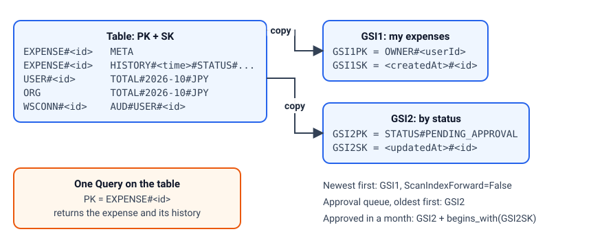
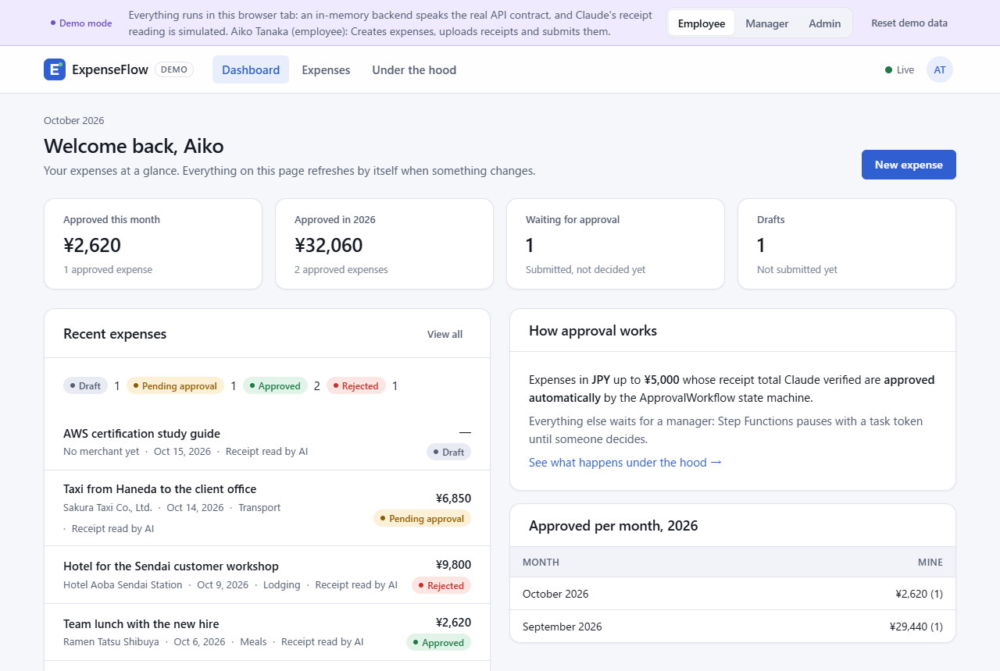

# Pattern 03: DynamoDB single-table design

Services: Amazon DynamoDB (on-demand, global secondary indexes, TTL, streams, point-in-time recovery).

## Problem

The app needs these reads, all fast and cheap, with no servers to size:

1. one expense **with its history**,
2. my expenses, newest first,
3. the approval queue, oldest first,
4. approved expenses of one month,
5. monthly totals per user and per organisation,
6. open WebSocket connections of a group.

DynamoDB has no joins. A query reads items that share one partition key, in sort-key order. So you design the keys **from the questions**, not from the entities.

## Pattern

Put every entity type in **one table** with generic key names (`PK`, `SK`). Give keys typed prefixes (`EXPENSE#`, `USER#`). Items that are read together share a PK (an *item collection*). Add a **global secondary index** (GSI) for each other sort order. Writes are guarded by **conditions**, so business rules are enforced atomically.



| Question | Operation |
|---|---|
| Expense and history | `Query PK = EXPENSE#<id>` (META item plus `HISTORY#...` items) |
| My expenses, newest first | `Query GSI1 GSI1PK = OWNER#<userId>`, `ScanIndexForward=False` |
| Approval queue | `Query GSI2 GSI2PK = STATUS#PENDING_APPROVAL` |
| Approved in month M | `Query GSI2 GSI2PK = STATUS#APPROVED AND begins_with(GSI2SK, "M-")` |
| Totals of a year | `Query PK = USER#<id> AND begins_with(SK, "TOTAL#2026-")` |

Remember when you design: DynamoDB bills per request unit, a `Scan` reads everything, and each item is limited to 400 KB.

## In ExpenseFlow

- [`keys.py`](../../backend/src/expenseflow/keys.py): **every** key format in one module. Application code never builds a key string by hand.
- [`repository.py`](../../backend/src/expenseflow/repository.py), class `ExpenseRepository`:
  - `get_with_history` (one Query), `list_by_owner` (GSI1), `list_pending_approval` (GSI2), `iter_approved_in_month` (GSI2 + `begins_with`), `get_totals`.
  - `_guard`: every write has the condition `ownerId = :owner AND status IN (...)` and, when the client sends `version`, `version = :v` (optimistic locking). A missing item has no `ownerId`, so the same condition also prevents UpdateItem from creating half-empty items.
  - `submit` puts the "required fields exist" rule **inside** the condition, so no concurrent PATCH can slip between validate and write.
  - `_failure` turns a failed condition into 403, 404 or 409 by reading the old item that `ReturnValuesOnConditionCheckFailure` returns.
  - Pagination cursors are the `LastEvaluatedKey`, Base64-encoded and validated.
- [`history.py`](../../backend/src/expenseflow/history.py), `_put_with_totals`: one `TransactWriteItems` writes the history item and `ADD`s to the user and organisation monthly totals. All or nothing, and `attribute_not_exists(SK)` makes a replay harmless.
- [`data_stack.py`](../../infra/expenseflow_infra/stacks/data_stack.py), `DataStack._single_table`: `TableV2`, on-demand billing, `dynamo_stream=NEW_AND_OLD_IMAGES` (a TableV2 without it synthesizes but fails at deploy), point-in-time recovery, TTL attribute `expiresAt`, deletion protection in prod. `_gsi` projects all attributes. `_idempotency_table` is a second small table for [pattern 10](10-sqs-dlq-idempotency.md).
- [`connections.py`](../../backend/src/expenseflow/connections.py): the same table also stores WebSocket connections, with TTL, see [pattern 11](11-websockets.md).

In the app, the dashboard's "Approved per month" table is the totals query:



## Same pattern in other industries

- **Ride hailing**: `TRIP#<id>` with its events; GSI by driver and day; a counter item per driver per week updated in a transaction.
- **Telecom**: `SUBSCRIBER#<id>` with its invoices and usage records in one partition; a GSI on invoice status for the billing run.
- **Online learning**: `COURSE#<id>` with lessons; `USER#<id>` with enrolments and progress; a GSI to list a teacher's courses.

## Hands-on

> Written from the code and the AWS documentation; not run against a real account by the author. Deploy first: [deploy guide](../expenseflow/deploy.md). Token and helper: [pattern 01, Hands-on](01-cognito-auth.md#hands-on).

**Console**

1. **DynamoDB > Tables**: open the table named in the `ExpenseFlow-Dev-Data` output `TableName`.
2. **Explore table items**: scan the table. Check column `entityType` (`Expense`, `History`, `MonthlyTotal`, `WsConnection`). This scan is fine for a learning table, never for a large production table.
3. Choose **Query**, **Table**, partition key `EXPENSE#<an id from your list>`: you get the META item and its `HISTORY#...` items in one call.
4. Choose **Query**, index `GSI2`, partition key `STATUS#APPROVED`. Compare the order with `GSI1`.
5. **Additional settings**: see *Point-in-time recovery* on, *Time to live* attribute `expiresAt`, stream view `New and old images`.

<!-- screenshot: DynamoDB > Tables > (table) > Explore table items > Query on PK = EXPENSE#<id> -->
<!-- screenshot: DynamoDB > Tables > (table) > Indexes > GSI1, GSI2 -->

**CLI (PowerShell)**: PowerShell 5.1 removes quotes inside JSON arguments, so JSON goes through a file.

```powershell
$table = Get-Output ExpenseFlow-Dev-Data TableName
'{":p":{"S":"STATUS#PENDING_APPROVAL"}}' | Set-Content values.json -Encoding ascii
aws dynamodb query --table-name $table --index-name GSI2 `
  --key-condition-expression "GSI2PK = :p" --expression-attribute-values file://values.json `
  --query "Items[].{id:id.S,title:title.S,status:status.S}" --output table
aws dynamodb describe-table --table-name $table --query "Table.{billing:BillingModeSummary.BillingMode,stream:StreamSpecification.StreamViewType,indexes:GlobalSecondaryIndexes[].IndexName}"
```

## Break it and fix it

**Experiment: lose an update, then keep it with optimistic locking.**

```powershell
$api = Get-Output ExpenseFlow-Dev-Backend ApiUrl
$auth = "Authorization: Bearer $env:ID_TOKEN"
'{"title":"Lock lab"}' | Set-Content create.json -Encoding ascii
$e = curl.exe -s -X POST "$api/expenses" -H $auth -H "Content-Type: application/json" --data "@create.json" | ConvertFrom-Json
$e.version                                   # 1
'{"title":"First edit","version":1}' | Set-Content edit.json -Encoding ascii
curl.exe -s -X PATCH "$api/expenses/$($e.id)" -H $auth -H "Content-Type: application/json" --data "@edit.json"   # OK, version is now 2
curl.exe -s -X PATCH "$api/expenses/$($e.id)" -H $auth -H "Content-Type: application/json" --data "@edit.json"   # 409
```

The second call returns **409** `expense was changed by someone else (version 2, you sent 1); reload it and try again`. The same condition expression that protects ownership and status also protects against stale writes. Fix: read the expense, send its current `version`. Clean up with `DELETE $api/expenses/<id>` (drafts can be deleted).

## Your turn (one pull request)

Add **approved totals per category** for the organisation.

- New key helper in `keys.py`, for example `PK = ORG`, `SK = CATEGORY#<yyyy-mm>#<category>#<currency>`.
- A third `_add_to_total` item in `_put_with_totals` (`history.py`). A transaction may hold up to 100 items.
- `ExpenseRepository.get_category_totals(year)` and a route such as `GET /stats/categories?year=2026` for managers and admins.
- Tests in `backend/tests/test_stream_processor.py` and `test_api_*`.

Acceptance: approving two MEALS expenses in October adds two to `CATEGORY#2026-10#MEALS#JPY` exactly once, even when the stream record is replayed.

## Interview questions

<details>
<summary>Show questions and short answers</summary>

1. **Why one table instead of one per entity?**
   Items read together can live in one partition and be fetched with one Query, in one round trip. Separate tables need several calls and cannot be updated in one transaction as simply. The cost is that you must know your access patterns early.
2. **What makes a good partition key?**
   High cardinality and even traffic. `EXPENSE#<ulid>` spreads load. A key such as `STATUS#PENDING_APPROVAL` is a hot partition in theory; it is acceptable here because the volume is small and it lives on a GSI.
3. **Query or Scan?**
   Query reads one partition (cheap, ordered). Scan reads every item and bills for all of them. Use Scan only for tiny tables or exports.
4. **How do you stop two users overwriting each other?**
   A version attribute plus `ConditionExpression version = :expected`. A failed condition returns `ConditionalCheckFailedException`, which the API maps to 409.
5. **When do you use `TransactWriteItems`?**
   When several items must change together (history plus two totals). It costs twice the write units. Single-item conditional writes are cheaper when one item is enough.
6. **On-demand or provisioned capacity?**
   On-demand for unknown or spiky traffic and idle-ish apps (pay per request). Provisioned with auto scaling when traffic is steady and you can predict it.

</details>

Next: [Pattern 04, S3 presigned uploads](04-s3-presigned-uploads.md).
