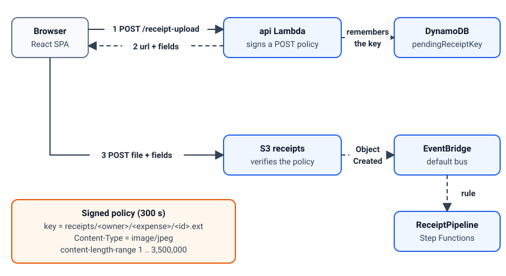

# Pattern 04: Direct browser uploads to S3 with a presigned POST

Services: Amazon S3 (private bucket, CORS, lifecycle, EventBridge notifications), an API Lambda that signs policies.

## Problem

Users upload receipt photos and PDFs of several MB. If the file travels through API Gateway and Lambda, you hit payload limits (10 MB and 6 MB), pay for Lambda time while bytes stream, and write extra code. But you cannot make the bucket public, and you cannot give the browser AWS credentials.

## Pattern

The API signs a short-lived **POST policy**: "you may upload exactly this key, with exactly this `Content-Type`, between 1 byte and N bytes, for the next 5 minutes". The browser then sends the file **directly to S3**. S3 checks the signature and the conditions itself. The Lambda never touches the file.



Why **POST** and not a presigned **PUT** URL: a PUT URL cannot limit the file size. A POST policy can (`content-length-range`).

After the upload, S3 emits an `Object Created` event to EventBridge. That event starts the processing ([pattern 07](07-step-functions-pipeline.md)). No API call has to say "the upload is finished".

## In ExpenseFlow

- [`routes_expenses.py`](../../backend/src/handlers/api/routes_expenses.py), `create_receipt_upload`:
  - builds the key `receipts/{ownerId}/{expenseId}/{ulid}{ext}` with `keys.receipt_object_key` ([`keys.py`](../../backend/src/expenseflow/keys.py)); a fresh id per upload avoids stale caches;
  - saves it first as `pendingReceiptKey` (`ExpenseRepository.set_pending_receipt`, a conditional write that also proves the caller owns the DRAFT);
  - signs with `generate_presigned_post`, `Conditions=[{"Content-Type": ...}, ["content-length-range", 1, max_bytes]]`, `ExpiresIn=300`.
- [`models.py`](../../backend/src/expenseflow/models.py), `ReceiptUploadRequest`: allowed types (JPEG, PNG, WebP, GIF, PDF) and the size limit (3,500,000 bytes, because Bedrock accepts 5 MB of Base64 per image).
- [`aws.py`](../../backend/src/expenseflow/aws.py), `s3_presigner`: SigV4, virtual-hosted style, regional endpoint, so the URL is `https://<bucket>.s3.<region>.amazonaws.com`.
- `get_receipt` in the same routes file: a presigned **GET** with `ResponseContentDisposition=inline`; the bucket stays private for reads too.
- [`data_stack.py`](../../infra/expenseflow_infra/stacks/data_stack.py), `_receipts_bucket`: versioning, CORS for `POST` and `GET` from the site origins, lifecycle (to Glacier Instant Retrieval after 365 days, expire after 7 years, old versions after 30 days, abort incomplete multipart uploads), and `_enable_eventbridge_notifications`, which sets the L1 property on `node.default_child` (an **escape hatch**; the L2 option would add a custom-resource Lambda).
- The bucket baseline (Block Public Access, TLS only, SSE-S3, no ACLs, access logs) is in [`constructs/__init__.py`](../../infra/expenseflow_infra/constructs/__init__.py), `private_bucket`.
- Browser: [`s3Upload.ts`](../../frontend/src/receipts/s3Upload.ts). All policy fields first, the file **last** (S3 ignores fields after the file part). It uses `XMLHttpRequest` because only XHR reports upload progress. [`prepare.ts`](../../frontend/src/receipts/prepare.ts) resizes big photos before upload.
- The pipeline accepts only the upload whose key equals `pendingReceiptKey`, so a replayed or forged policy cannot attach a file ([`receipt_pipeline.py`](../../infra/expenseflow_infra/constructs/receipt_pipeline.py), `MarkProcessing`).

## Same pattern in other industries

- **Insurance**: claim photos and police reports uploaded from a phone; the size limit stops a 2 GB video from filling the bucket.
- **Real estate**: agents upload listing photos; the event starts a resize and watermark job.
- **Healthcare**: lab result PDFs from partner clinics. Short expiry and one key per upload keep the permission narrow.

## Hands-on

> Written from the code and the AWS documentation; not run against a real account by the author. Deploy first: [deploy guide](../expenseflow/deploy.md). Token and helper: [pattern 01, Hands-on](01-cognito-auth.md#hands-on). Run the commands from the repository root.

**Console**

1. **S3 > Buckets**: open the bucket named in the `ExpenseFlow-Dev-Data` output `ReceiptsBucketName`.
2. **Permissions**: *Block public access* is on for all four settings; *Cross-origin resource sharing* lists your site origin with `POST` and `GET`.
3. **Properties > Amazon EventBridge**: *Send notifications to Amazon EventBridge* is **On**.
4. **Management > Lifecycle rules**: `archive-and-expire` and `remove-expired-delete-markers`.
5. Upload a receipt in the app (**New expense**, *Choose a file*). Then browse **Objects > receipts/**: folder per owner id, folder per expense id, one object named with a ULID.

<!-- screenshot: S3 > Buckets > (receipts bucket) > Properties > Amazon EventBridge -->
<!-- screenshot: S3 > Buckets > (receipts bucket) > Objects > receipts/<owner>/<expense>/ -->

**CLI (PowerShell)**: do by hand what the browser does.

```powershell
$api  = Get-Output ExpenseFlow-Dev-Backend ApiUrl
$auth = "Authorization: Bearer $env:ID_TOKEN"
'{"title":"Upload lab"}' | Set-Content create.json -Encoding ascii
$e = curl.exe -s -X POST "$api/expenses" -H $auth -H "Content-Type: application/json" --data "@create.json" | ConvertFrom-Json

$size = (Get-Item samples\sample-receipt.pdf).Length
"{`"contentType`":`"application/pdf`",`"size`":$size}" | Set-Content upload.json -Encoding ascii
$p = curl.exe -s -X POST "$api/expenses/$($e.id)/receipt-upload" -H $auth -H "Content-Type: application/json" --data "@upload.json" | ConvertFrom-Json
$p.key; $p.expiresIn; $p.maxBytes

$form = foreach ($f in $p.fields.PSObject.Properties) { '--form-string'; "$($f.Name)=$($f.Value)" }
curl.exe -i $p.url @form -F "file=@samples/sample-receipt.pdf;type=application/pdf"
```

Expect `HTTP/1.1 204 No Content`. A few seconds later `curl.exe -s -H $auth "$api/expenses/$($e.id)"` shows `extraction.status` `PROCESSING`, then `SUCCEEDED` (if Bedrock is enabled, see [pattern 06](06-bedrock-ai-extraction.md)).

## Break it and fix it

Every experiment needs a fresh policy: run the `receipt-upload` call again to get `$p`.

**1. Wrong `Content-Type` field.** Rebuild the form with another type:

```powershell
$bad = foreach ($f in $p.fields.PSObject.Properties) { $v = $f.Value; if ($f.Name -eq 'Content-Type') { $v = 'image/png' }; '--form-string'; "$($f.Name)=$v" }
curl.exe -i $p.url @bad -F "file=@samples/sample-receipt.pdf"
```

S3 answers **403 AccessDenied**, `Invalid according to Policy: Policy Condition failed`.

**2. File too large.**

```powershell
fsutil file createnew big.bin 4000000
curl.exe -i $p.url @form -F "file=@big.bin"
```

S3 answers **400 EntityTooLarge**. (Asking the API for `"size":4000000` is refused earlier with 422 `receipt_too_large`.)

**3. Expired policy.** Wait more than 5 minutes, then upload: 403, policy expired.

**What you learn**: the rules live in the signed policy and S3 enforces them. Fix every case the same way: ask the API for a new policy and stay inside the limits. Clean up: `Remove-Item big.bin`, delete the draft expense.

## Your turn (one pull request)

Let the user **download** a receipt instead of viewing it: add `GET /expenses/{id}/receipt?download=true`.

- In `get_receipt` set `ResponseContentDisposition` to `attachment; filename="..."` when `download` is true.
- Add a test in `backend/tests/test_api_receipts.py` that decodes the presigned URL and checks the signed `response-content-disposition`.
- Optional: a "Download" link in `frontend/src/components/ReceiptPreview.tsx`.

## Interview questions

<details>
<summary>Show questions and short answers</summary>

1. **Why upload directly to S3?**
   Large files do not fit API Gateway and Lambda limits, cost compute time, and add failure points. S3 is built for uploads and scales alone.
2. **Presigned POST or presigned PUT?**
   POST policies can enforce size and content type. PUT URLs sign only the method, key and expiry (and headers you include).
3. **Does a presigned URL work longer than the credentials that signed it?**
   No. It stops working when those credentials expire. Lambda uses temporary role credentials, so keep the expiry short (here 300 s).
4. **Why must the bucket have CORS rules?**
   The upload is a cross-origin request from the site's origin to the bucket's domain. Without CORS the browser blocks it.
5. **How do you protect against malware in uploads?**
   Scan after upload (for example Amazon GuardDuty Malware Protection for S3) and quarantine before processing. This app only reads the file to send it to Claude.
6. **What if S3 delivers the event twice?**
   S3 events are at least once. The pipeline's first step is a conditional update that removes `pendingReceiptKey`; the duplicate fails the condition and stops.

</details>

Next: [Pattern 05, CloudFront single-page-app hosting](05-cloudfront-spa-hosting.md).
