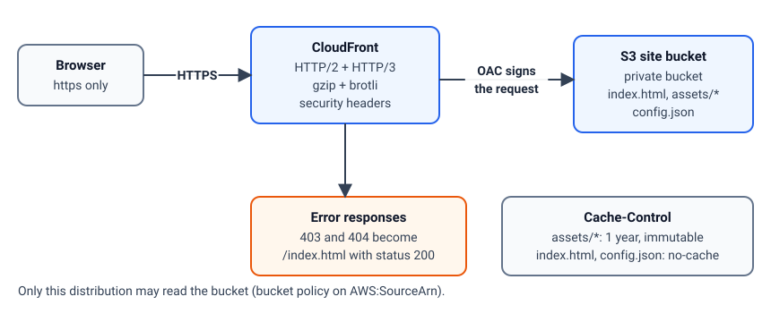

# Pattern 05: Host a single-page app with CloudFront and a private S3 bucket

Services: Amazon CloudFront, Amazon S3, AWS CDK `BucketDeployment`.

## Problem

A React app is a set of static files. You want HTTPS, fast loads from Japan and from abroad, security headers, and a deployment that shows up immediately. You do not want a public bucket, because "public bucket" is how data leaks happen. And the browser router owns URLs like `/expenses/01J...`, so a refresh on such a URL must still load the app.

## Pattern

Keep the files in a **private** S3 bucket. Put **CloudFront** in front. CloudFront reads the bucket through **Origin Access Control (OAC)**: it signs each origin request, and the bucket policy allows only this distribution. Visitors can reach files only through the CDN. Unknown paths fall back to `index.html` so the client-side router can render them.



Cache rules decide how a release becomes visible:

- Hashed files (`assets/index-B4x9.js`) never change, so they are cached for a year.
- `index.html` and `config.json` keep their names, so they are `no-cache`: the browser revalidates on every load.

## In ExpenseFlow

- [`edge_stack.py`](../../infra/expenseflow_infra/stacks/edge_stack.py), `EdgeStack._distribution`:
  - `S3BucketOrigin.with_origin_access_control(site_bucket)` (OAC with SigV4);
  - `REDIRECT_TO_HTTPS`, managed `CACHING_OPTIMIZED` cache policy and `SECURITY_HEADERS` response-headers policy, compression, HTTP/2 and HTTP/3;
  - `error_responses`: 403 and 404 become `/index.html` with status 200, TTL 0. S3 answers a missing key with 403 (not 404) when the caller lacks `s3:ListBucket`, so both are mapped;
  - price class 200 (no South America and Oceania edge locations, cheaper);
  - the `acknowledge(...)` calls explain, one by one, why cdk-nag findings (geo restriction, WAF, logging, default certificate) are accepted for a learning project.
  - **Gotcha in the comment**: the bucket and the distribution must be in the **same stack**. Across two stacks the bucket policy needs the distribution ARN and the distribution needs the bucket name: a dependency cycle.
- [`constructs/__init__.py`](../../infra/expenseflow_infra/constructs/__init__.py), `private_bucket`: Block Public Access, TLS only, encryption, no ACLs, access logs.
- [`frontend_stack.py`](../../infra/expenseflow_infra/stacks/frontend_stack.py), `FrontendStack`:
  - `DeployAssets`: all files except `index.html`, `config.json` and source maps, `Cache-Control: public, max-age=31536000, immutable`;
  - `DeployEntry`: `index.html` plus a generated `config.json` (`Source.json_data`), `no-cache`, then a CloudFront invalidation of `/index.html` and `/config.json`;
  - `prune=False` on both, so a browser that still runs the previous `index.html` can load its old chunks during a release;
  - the entry deployment depends on the assets deployment: the new `index.html` never points to files that are not uploaded yet.
- [`config.ts`](../../frontend/src/config.ts): the app fetches `/config.json` before React starts, so **one build runs against any stage**. The user pool id and API URLs exist only after the other stacks deployed; `Source.json_data` writes them into the file during deployment.
- [`vite.config.ts`](../../frontend/vite.config.ts): content-hashed file names and vendor chunks that stay stable between releases.

## Same pattern in other industries

- **Documentation or marketing site**: static files, OAC, invalidate only `index.html` on release.
- **Internal admin console** of a factory: the same private bucket and CDN; access is limited by the API's authorizer, not by hiding the site.
- **Event or campaign micro-site**: price class and caching decide the cost during a traffic spike; origin load stays small because the edge answers.

## Hands-on

> Written from the code and the AWS documentation; not run against a real account by the author. Deploy first: [deploy guide](../expenseflow/deploy.md). Helper `Get-Output`: [pattern 01, Hands-on](01-cognito-auth.md#hands-on).

**Console**

1. **CloudFront > Distributions**: open the id from the `ExpenseFlow-Dev-Edge` output `DistributionId`.
2. **Origins**: one S3 origin with an *Origin access control* (not "public").
3. **Behaviors**: viewer protocol policy *Redirect HTTP to HTTPS*, the cache policy and the response-headers policy.
4. **Error pages**: 403 and 404 map to `/index.html` with response code 200 and TTL 0.
5. **Invalidations**: after each deployment you see `/index.html` and `/config.json`.
6. **S3 > (site bucket) > Permissions > Bucket policy**: one statement for `cloudfront.amazonaws.com` with a `AWS:SourceArn` condition.

<!-- screenshot: CloudFront > Distributions > (id) > Origins > Origin access -->
<!-- screenshot: CloudFront > Distributions > (id) > Error pages -->

**CLI (PowerShell)**

```powershell
$site   = Get-Output ExpenseFlow-Dev-Edge SiteUrl
$bucket = Get-Output ExpenseFlow-Dev-Edge SiteBucketName
curl.exe -I $site                                     # 200, HSTS and other security headers
curl.exe -I ("http://" + $site.Substring(8))          # 301 redirect to https
curl.exe -s "$site/config.json"                       # the generated runtime configuration
$asset = (curl.exe -s $site | Select-String 'assets/[^"]+\.js').Matches[0].Value
curl.exe -I "$site/$asset"; curl.exe -I "$site/$asset" # second answer: x-cache Hit from cloudfront
curl.exe -I "https://$bucket.s3.$env:AWS_REGION.amazonaws.com/index.html"   # 403: no direct access
```

## Break it and fix it

**Experiment: a missing file looks like a success.**

```powershell
curl.exe -I "$site/expenses/not-a-file"        # 200: fine, the router will handle it
curl.exe -I "$site/assets/old-chunk-abc123.js" # 200 too, with content-type text/html
```

The second answer is the side effect of the SPA fallback: a **missing script** returns HTML with status 200. In a browser, a user with an old tab that asks for a chunk of a previous release sees `Unexpected token '<'` instead of a clean 404. `prune=False` reduces the chance (old chunks stay), but does not remove it.

Fix options: keep old chunks long enough (done), or serve the fallback only for paths without a file extension. The second is the challenge below.

## Your turn (one pull request)

Replace the blanket 403/404 mapping by a **CloudFront Function** that rewrites only extension-less paths to `/index.html`.

- In `edge_stack.py` add a `cloudfront.Function` (JavaScript runtime 2.0) as a `VIEWER_REQUEST` association and remove `error_responses`.
- Update `infra/tests/test_edge_stack.py` and keep `cdk synth` (with cdk-nag) green.
- Note in the PR what the browser now gets for `/assets/missing.js`: S3 still answers 403 for missing keys without `s3:ListBucket`. Decide if a 403 is good enough or if you map it to 404 for `/assets/*` only.

## Interview questions

<details>
<summary>Show questions and short answers</summary>

1. **Why not S3 static website hosting?**
   It has no HTTPS on its own domain, needs a public bucket, and has no edge caching. CloudFront adds all three and works with a private bucket.
2. **OAC or OAI?**
   OAC is the current mechanism: SigV4 signing, supports SSE-KMS and all Regions. OAI is the legacy one.
3. **How do users see a new release?**
   Hashed asset names mean new URLs. `index.html` is `no-cache` and is also invalidated, so the next page load fetches the new entry point.
4. **Why a runtime `config.json`?**
   One build, many stages. Values created at deploy time (pool id, API URL) do not need a rebuild.
5. **Where must an ACM certificate for a CloudFront custom domain live?**
   In `us-east-1`, whatever Region the rest of the app uses.
6. **CORS or CloudFront for the API?**
   Different jobs. CloudFront here serves only static files. API calls go to the API Gateway domain, which needs its own CORS configuration ([pattern 02](02-api-gateway-lambda.md)).

</details>

Next: [Pattern 06, AI extraction with Amazon Bedrock](06-bedrock-ai-extraction.md).
