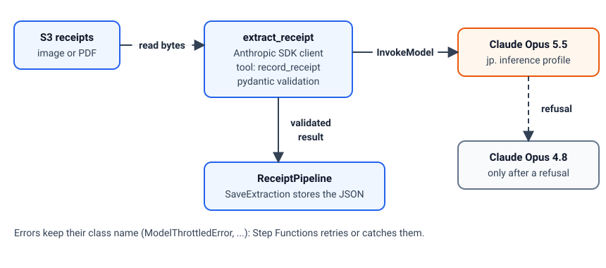
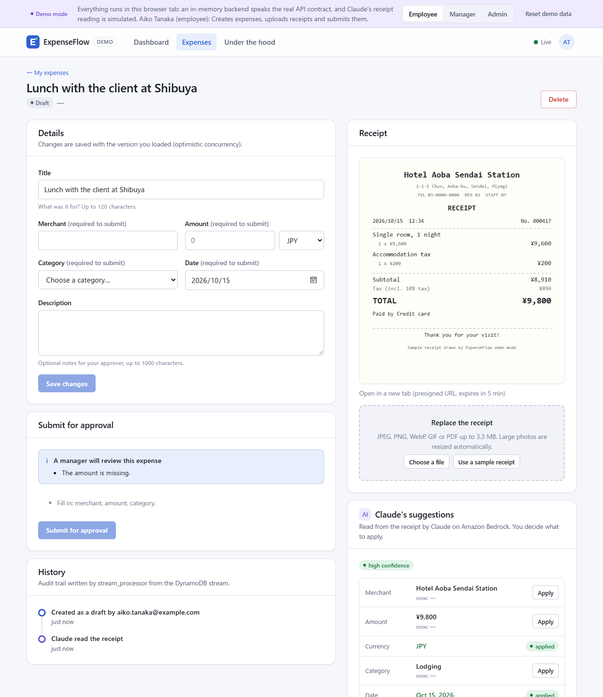

# Pattern 06: AI extraction with Claude on Amazon Bedrock

Services: Amazon Bedrock (Claude, cross-Region inference profile), AWS Lambda, Step Functions, CloudWatch metrics.

## Problem

Typing a receipt into a form is slow and error-prone. A model can read a photo and suggest the merchant, date, total and category. But a model can be wrong, can refuse, can be throttled, and its input (a receipt) is **untrusted data**. The design must stay safe and cheap when any of that happens.

## Pattern

A Lambda function reads the receipt from S3 and calls the model through the **Anthropic SDK for Bedrock**. The model must answer by calling a **tool** whose input schema is the data you want. You validate that input with pydantic. The result is a *suggestion*: a person applies it ("human in the loop"). Failures become typed exceptions that the workflow can retry or catch.



Design choices that matter:

- **Tool use instead of structured outputs.** Bedrock does not support the structured-output parameter, so the tool schema is the contract. `tool_choice` stays `auto`: forcing a tool returns HTTP 400 on Claude Opus 5.5, so the system prompt tells the model to call the tool.
- **Inference profile.** In Tokyo the model id is `jp.anthropic.claude-opus-5-5`. The `jp.` prefix is a *geographic inference profile*: requests are routed inside Tokyo and Osaka (data stays in Japan).
- **Refusal fallback.** A safety refusal is an HTTP 200 with `stop_reason == "refusal"`. The SDK middleware re-sends the request to a fallback model (`jp.anthropic.claude-opus-4-8`).
- **Typed errors.** Retryable: `ModelThrottledError`, `ModelUnavailableError`. Final: `ModelRequestError`, `UnsupportedInputError`, `ExtractionRefusedError`, `ExtractionInvalidError`. Lambda reports the exception class name, and Step Functions matches it ([pattern 07](07-step-functions-pipeline.md)).
- **Treat the receipt as data.** A receipt could contain text like "ignore your instructions". The model can only fill a fixed schema, the output is validated, and nothing is applied without a human click.

## In ExpenseFlow

- [`receipts.py`](../../backend/src/expenseflow/receipts.py)
  - `get_client` builds `AnthropicBedrock(aws_region=..., middleware=[refusal fallback], max_retries=1)`.
  - `extract_receipt` sends the image or PDF block **before** the text block, uses `TOOL` (`record_receipt`) with `tool_choice={"type": "auto"}` and `output_config={"effort": "low"}` (no `thinking` parameter), `max_tokens=8192`, and wraps the call in `BetaFallbackState`.
  - `sniff_media_type` trusts the file's magic bytes, not the declared type.
  - `ReceiptData` is the pydantic model; its field descriptions are part of the prompt.
  - `request_timeout_s` shortens the HTTP timeout to fit the Lambda's remaining time, so a slow call fails as a *retryable* error and Lambda never kills it mid-request.
- [`extract_receipt.py`](../../backend/src/handlers/extract_receipt.py): reads the object (a `HeadObject` size check first), calls `receipts.extract_receipt`, logs the Bedrock request id, and emits metrics `ExtractionLatencyMs`, `ExtractionInputTokens`, `ExtractionOutputTokens`, `ExtractionFallbackUsed` with the dimension `Model`.
- [`backend_stack.py`](../../infra/expenseflow_infra/stacks/backend_stack.py), `_extract_receipt` and `_bedrock_statement`: timeout 180 s, memory 512 MB, and IAM for `bedrock:InvokeModel` on the **inference-profile ARN and on the foundation-model ARNs in every Region** the profile may use. Missing the second part is the classic `AccessDenied`.
- [`config.py`](../../infra/expenseflow_infra/config.py): `inference_profile_prefix` (`ap-northeast-1` gives `jp`), `default_model_id`. Context keys: `bedrockRegion`, `extractionModelId`, `extractionFallbackModelId` (`none` switches the model or only the fallback off).
- [`check_bedrock.py`](../../scripts/check_bedrock.py): run **once with admin credentials**. The first call to an Anthropic model in an account subscribes the account through AWS Marketplace, which needs `aws-marketplace:Subscribe`. The Lambda deliberately does not have that permission (least privilege).
- UI: [`AiPanel.tsx`](../../frontend/src/components/AiPanel.tsx) shows each suggestion with an **Apply** button. The workflow uses the extracted total to decide auto-approval ([pattern 08](08-task-token-approvals.md)).



## Same pattern in other industries

- **Accounts payable**: read supplier invoices (number, due date, bank account). A clerk confirms before payment.
- **Logistics**: read delivery notes and damage photos; flag low-confidence reads for review.
- **Insurance**: read a vehicle registration or a medical form into a claim record, with the original image kept for audit.

## Hands-on

> Written from the code and the AWS documentation; not run against a real account by the author. Deploy first: [deploy guide](../expenseflow/deploy.md).
> **Plan and cost.** Bedrock is probably not available on the AWS *Free plan*; you may need to upgrade to the *Paid plan*. A receipt costs roughly US$0.02 to 0.06 with Claude Opus 5.5. This is our estimate from token counts; check the current Bedrock price page and your own token metrics below.

**Console**

1. **Amazon Bedrock > Model catalog**, search "Claude Opus 5.5": read the model card and the Regions it supports.
2. **Amazon Bedrock > Cross-Region inference** (the menu name may differ): find the `jp.` profile and the Regions it covers.
3. **Lambda > Functions**: open the function whose name contains `ExtractReceiptFunction`. **Configuration > Environment variables**: `BEDROCK_REGION`, `EXTRACTION_MODEL_ID`, `EXTRACTION_FALLBACK_MODEL_ID`. **Configuration > Permissions**: open the role and find the `bedrock:InvokeModel` statement.
4. **CloudWatch > Metrics > All metrics > ExpenseFlow**: choose the `Model` dimension and graph `ExtractionInputTokens` and `ExtractionOutputTokens` (Sum).

<!-- screenshot: Bedrock > Model catalog > Claude Opus 5.5 -->
<!-- screenshot: Lambda > ExtractReceiptFunction > Configuration > Environment variables -->
<!-- screenshot: CloudWatch > Metrics > ExpenseFlow > Model > ExtractionInputTokens -->

**CLI (PowerShell)**: with the repository's virtualenv active (`pip install -r backend/requirements-dev.txt`):

```powershell
python scripts/check_bedrock.py --profile expenseflow --region ap-northeast-1
```

Then upload `samples/sample-receipt.pdf` in the app (New expense, *Choose a file*). In **CloudWatch > Logs > Logs Insights**, select the log group of the extraction function and run:

```
fields @timestamp, expense_id, model, usage.input_tokens, usage.output_tokens, fallback_used, confidence
| filter message = "receipt extracted"
| sort @timestamp desc
| limit 20
```

Multiply the token counts by the prices of the Bedrock price page to get your own cost per receipt.

## Break it and fix it

**Experiment 1: something that is not a receipt.** Upload a screenshot or a photo of your desk. Claude calls the tool with `isReceipt: false`. The AI panel shows *This does not look like a receipt* and offers nothing to apply. Nothing failed: the schema has a field for "not a receipt" so the model never has to guess.

**Experiment 2: switch AI off.**

```powershell
.\scripts\deploy.ps1 -c extractionModelId=none
```

The extraction function is not deployed. The ReceiptPipeline uses `MarkSkipped`, and the app says AI extraction is switched off for this deployment. (The Frontend stack is redeployed too, because `config.json` carries `extractionEnabled`.) Fix: deploy again without the `-c` option. If the GitHub deploy is switched on ([phase 9](../playbook/09-cicd.md)), also set the repository variable `EXTRACTION_MODEL_ID` to the model id (for example `au.anthropic.claude-opus-5-5` in Sydney). Otherwise the next merge to `main` deploys with `extractionModelId=none` and AI is off again.

**What you learn**: a feature flag at deploy time changes the workflow graph, not just a variable. Failure modes (not a receipt, throttled, refused, off) all end in a state the user understands.

## Your turn (one pull request)

Japan's invoice system uses a registration number: `T` followed by 13 digits. Ask Claude for it.

- Add an optional `invoice_registration_number` field to `ReceiptData` in `receipts.py` with a short description and a pattern check (`^T\d{13}$`), and include it in `ExtractionResult.to_output`.
- Extend `backend/tests/test_receipts.py` (the tests use a mocked HTTP transport; no real call is made).
- Show the value in `AiPanel.tsx` and add the field to `frontend/src/api/types.ts`.

Acceptance: a receipt with `T1234567890123` shows the number; a receipt without one shows nothing and still passes validation.

## Interview questions

<details>
<summary>Show questions and short answers</summary>

1. **Why tool use for extraction?**
   The tool's `input_schema` is a machine-checkable contract. The model returns structured arguments, you validate them, and you never parse free text.
2. **What is an inference profile?**
   A routing alias over several Regions. It gives capacity and optional data-residency control (`jp.` stays in Japan). IAM must allow the profile and the underlying model in each Region.
3. **How do you defend against prompt injection in a receipt?**
   Constrain output to a schema, validate it, give the model no tools with side effects, and require human approval before data is used.
4. **What happens when Bedrock throttles (HTTP 429)?**
   The client raises `ModelThrottledError`, Lambda reports that class name, and the state machine retries with exponential backoff and jitter. Non-retryable errors go to `MarkFailed`.
5. **How do you control cost?**
   Resize images before upload, cap `max_tokens`, use low effort, retry sparingly, and watch the token metrics and the AWS Budget.
6. **Why does the Lambda not have Marketplace permissions?**
   The subscription is a one-time admin action. Granting `aws-marketplace:Subscribe` to a function that processes user uploads would be unnecessary privilege.

</details>

Next: [Pattern 07, Step Functions pipeline](07-step-functions-pipeline.md).
