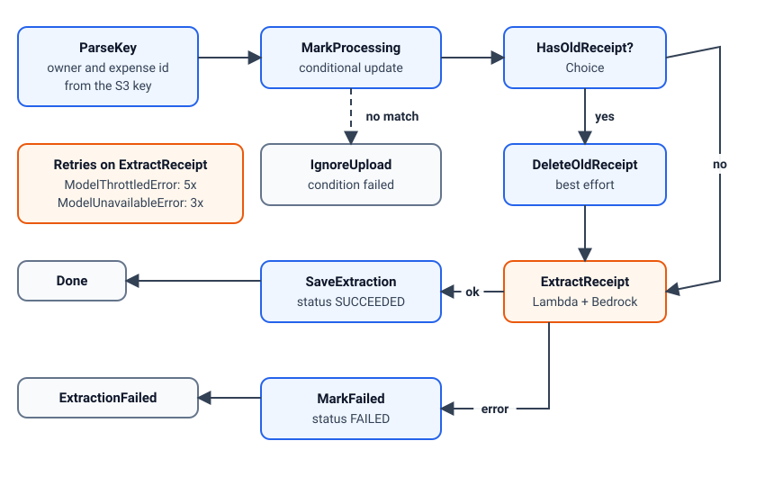

# Pattern 07: A processing pipeline with Step Functions

Services: AWS Step Functions (Standard, JSONata), Amazon EventBridge (default bus rule), direct DynamoDB and S3 integrations, Lambda.

## Problem

After a receipt lands in S3, several steps must happen in order: attach it to the right expense, remove the receipt it replaces, call a slow and sometimes failing AI model, and store the result or the failure. Each step can fail, can be retried, and may be triggered twice. Writing this as nested `try/except` inside one Lambda hides the flow and makes retries hard to reason about.

## Pattern

A **state machine** describes the flow as data: states, transitions, `Retry` and `Catch`. Step Functions runs it, keeps the history of each execution and shows it as a graph. Simple steps (a DynamoDB update, an S3 delete) are **direct service integrations**: no Lambda, no code to maintain. Only real logic (the model call) is a Lambda task.



What to notice:

- **The start signal is an event.** S3 sends `Object Created` to the default EventBridge bus; a rule starts one execution ([pattern 04](04-s3-presigned-uploads.md)).
- **Idempotency by conditional write.** `MarkProcessing` requires `pendingReceiptKey = :key` and removes it. A duplicate event, a replayed event or a forged upload fails the condition and ends in `IgnoreUpload`.
- **Data stays out of the payload.** A state's payload is limited to 256 KiB, so the Lambda gets the S3 key, not the bytes.
- **Handled failure is a success.** `ExtractionFailed` is a `Succeed` state: the receipt is attached, the user can type the fields, and the execution does not raise an alarm. Only unexpected errors fail an execution.
- **Stale results are dropped.** `SaveExtraction` and `MarkFailed` require `receiptKey = :key`. If the user uploaded a newer receipt meanwhile, the result ends in `Superseded`.

## In ExpenseFlow

- [`receipt_pipeline.py`](../../infra/expenseflow_infra/constructs/receipt_pipeline.py), class `ReceiptPipeline`. States: `ParseKey` (Pass), `MarkProcessing` (DynamoDB UpdateItem), `HasOldReceipt` (Choice), `DeleteOldReceipt` (S3 DeleteObject, best effort), `ExtractReceipt` (Lambda), `SaveExtraction`, `MarkFailed`, `MarkSkipped` (when AI is off), and the `Succeed` states `Done`, `IgnoreUpload`, `Superseded`, `ExtractionFailed`.
  - `ExtractReceipt` retries `ModelThrottledError` (10 s, up to 5 attempts, doubling, max 120 s, full jitter) and `ModelUnavailableError` (5 s, 3 attempts). `Catch` of all errors goes to `MarkFailed`.
  - `ParseKey` splits `receipts/{ownerId}/{expenseId}/{file}`: the key itself says which expense it belongs to.
- [`approval_workflow.py`](../../infra/expenseflow_infra/constructs/approval_workflow.py): the shared helpers: `jsonata_state_machine` (JSONata, tracing on, execution logs at level ALL), `update_expense` (UpdateItem with a condition and a `Catch` for `DynamoDB.ConditionalCheckFailedException`), `retry_transient`.
- **JSONata** (`query_language=JSONATA`): states read data with `` and keep values in variables (`Assign`). Only the `.jsonata(...)` factories are used. The JSONPath helpers such as `sfn.JsonPath.*` produce text that a JSONata state does not evaluate.
- **Error names differ by integration.** The optimized DynamoDB integration reports `DynamoDB.ConditionalCheckFailedException`; the generic AWS SDK integration reports `DynamoDb.ConditionalCheckFailedException`. A `Catch` with the wrong spelling never matches. See the constants at the top of `approval_workflow.py`.
- [`backend_stack.py`](../../infra/expenseflow_infra/stacks/backend_stack.py), `_route_events`: `ReceiptUploadedRule` (source `aws.s3`, detail type `Object Created`, bucket name, key prefix `receipts/`) with the dead-letter queue `ReceiptRuleDlq`.

## Same pattern in other industries

- **Media**: upload, transcode, thumbnail, publish. A failed transcode is a handled branch, not a crash.
- **Banking**: onboarding steps (identity check, sanctions check, account creation) with retries per call and a human-review branch.
- **E-commerce**: order fulfilment with payment, stock and shipping steps, and compensation when a step fails.

## Hands-on

> Written from the code and the AWS documentation; not run against a real account by the author. Deploy first: [deploy guide](../expenseflow/deploy.md). Helper `Get-Output`: [pattern 01, Hands-on](01-cognito-auth.md#hands-on). Upload a receipt first (any way from [pattern 04](04-s3-presigned-uploads.md)).

**Console**

1. **Step Functions > State machines**: open the machine named in the output `ReceiptStateMachineArn` (its name starts with `ReceiptPipeline`).
2. **Executions**: one per upload. Open the latest.
3. **Graph view**: the path taken is colored. Click a state, see *Input* and *Output* (JSONata variables are under *Variables*).
4. **Table view / Events**: the state-by-state history with timestamps. Find how long `ExtractReceipt` took.
5. **Definition** tab: read the generated Amazon States Language.
6. **X-Ray**: in the execution page, *Trace map* connects the state machine to Lambda and DynamoDB.

<!-- screenshot: Step Functions > State machines > ReceiptPipeline > Executions > (execution) > Graph view -->
<!-- screenshot: Step Functions > (execution) > Table view -->

**CLI (PowerShell)**

```powershell
$sm = Get-Output ExpenseFlow-Dev-Backend ReceiptStateMachineArn
aws stepfunctions list-executions --state-machine-arn $sm --max-items 5 `
  --query "executions[].{name:name,status:status,start:startDate}" --output table
$exec = aws stepfunctions list-executions --state-machine-arn $sm --max-items 1 --query "executions[0].executionArn" --output text
aws stepfunctions get-execution-history --execution-arn $exec `
  --query "events[?contains(type,'StateEntered')].stateEnteredEventDetails.name" --output text
```

## Break it and fix it

**Experiment: replay an old execution.**

1. In the console open a *Succeeded* execution of the ReceiptPipeline.
2. Choose **Start new execution**. The input is pre-filled with the same S3 event.
3. Start it and open the graph.

The new execution ends at `IgnoreUpload`. `MarkProcessing` required `pendingReceiptKey = :key`, and the first run removed that attribute. The same event cannot attach the same file twice.

**Fix / lesson**: nothing is broken; this is the safety net. To process a receipt again, upload it again (a new key, a new pending marker). If you ever saw a duplicate effect, the condition on the first write is the place to look.

**Bonus**: deploy with `-c extractionModelId=none` and see `MarkSkipped` replace `ExtractReceipt` ([pattern 06](06-bedrock-ai-extraction.md)).

## Your turn (one pull request)

Raise an alarm when an execution **times out**, not only when it fails.

- In [`monitoring.py`](../../infra/expenseflow_infra/constructs/monitoring.py) add alarms for `ExecutionsTimedOut` of both state machines next to the existing `ExecutionsFailed` alarms (`sfn.StateMachine.metric_timed_out`).
- Update the test in `infra/tests/test_backend_stack.py` and keep the real `cdk synth` with cdk-nag green.

## Interview questions

<details>
<summary>Show questions and short answers</summary>

1. **Standard or Express workflow?**
   Standard: up to a year, exactly-once execution semantics, full history, billed per state transition. Express: up to 5 minutes, at-least-once, very high rates, billed by duration. A pipeline with a wait for humans needs Standard.
2. **What is the difference between `Retry` and `Catch`?**
   `Retry` runs the same state again after a delay. When retries are exhausted (or none match), `Catch` routes the error to another state. Retries are evaluated first.
3. **Why pass an S3 key and not the file?**
   A state payload is limited to 256 KiB. Pass references, not data.
4. **Why use direct integrations?**
   No Lambda to write, deploy, patch or pay for, and fewer cold starts. Use Lambda for logic the language cannot express.
5. **Why is `ExtractionFailed` a Succeed state?**
   The failure is an expected, handled outcome. Failing the execution would raise alarms for something the user can fix by typing.
6. **How do you make a workflow idempotent?**
   Conditional writes on the first step that has an effect, and idempotency keys on later steps. Here the condition is `pendingReceiptKey = :key`.

</details>

Next: [Pattern 08, Approvals with task tokens](08-task-token-approvals.md).
