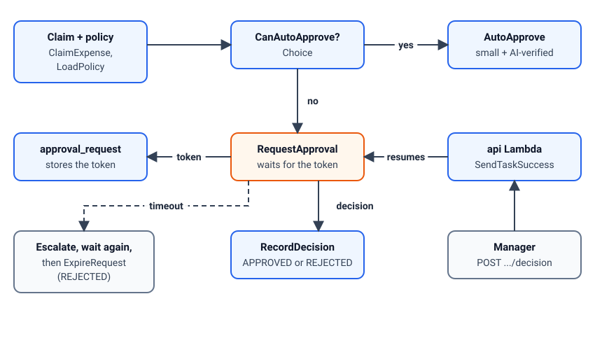
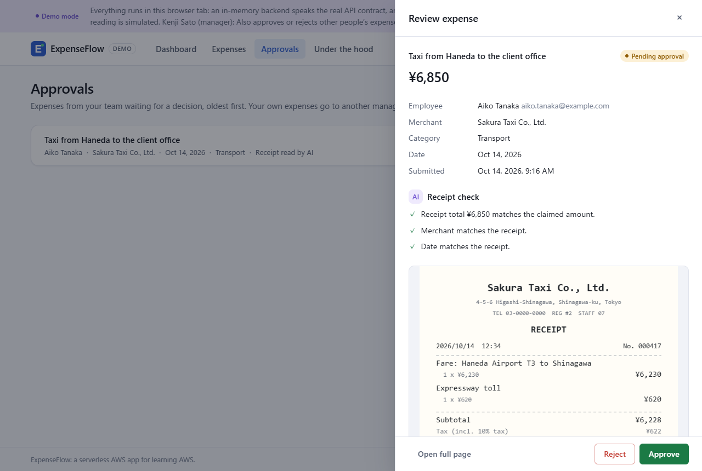
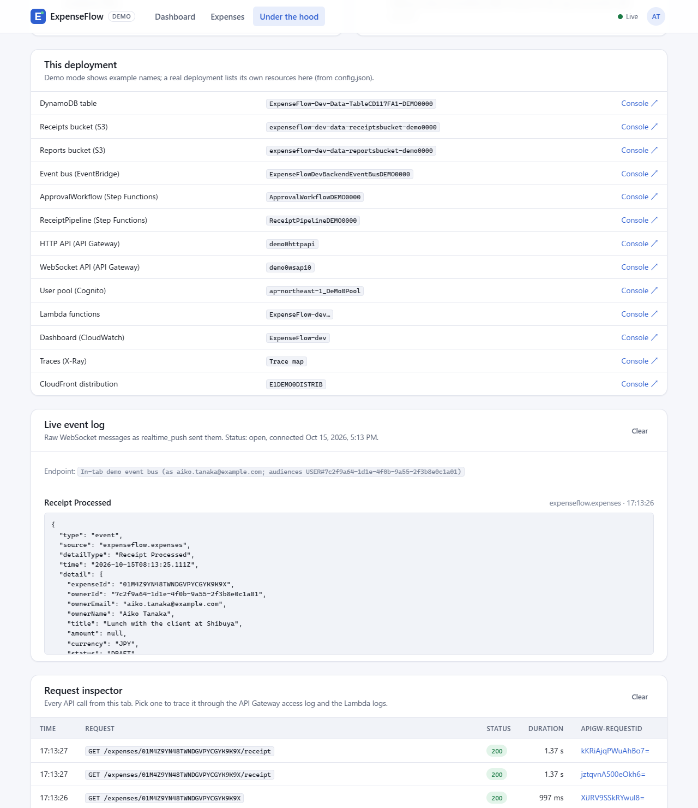

# Pattern 08: Human approval with a Step Functions task token

Services: AWS Step Functions (`.waitForTaskToken`), Lambda, DynamoDB, SSM Parameter Store, API Gateway.

## Problem

Some expenses need a manager. That can take minutes or days. During the wait something must remember the state, nothing should cost money, and the system must handle the awkward cases: the owner withdraws the request, two managers click at the same time, nobody answers, the answer arrives late.

## Pattern

The **callback pattern**. A workflow step starts a task and receives a one-time **task token**. The workflow then *pauses* (free for a Standard workflow). Somebody stores the token. Later, any program that holds the token calls `SendTaskSuccess(token, output)` and the workflow continues with that output. A task timeout turns "nobody answered" into a normal path.



Rules of the pattern:

- **The token is a bearer credential** for that workflow step. Store it where only the code that needs it can read it. Never log it and never return it from the API.
- **A token works once.** The second of two concurrent decisions gets an error. That gives you the "first decision wins" rule without a lock.
- **Guard every write with the expected state.** Withdrawing, deciding and timing out can race. Each state write is conditional on `status = PENDING_APPROVAL`, so the loser ends in `AlreadyHandled` instead of overwriting the winner.
- **Policy lives outside the code.** The auto-approval limit is read from an SSM parameter on every execution.

## In ExpenseFlow

- [`approval_workflow.py`](../../infra/expenseflow_infra/constructs/approval_workflow.py), class `ApprovalWorkflow`. States: `Init`, `ClaimExpense` (conditional write that also stores `workflowExecutionArn`), `LoadPolicy` (SSM `GetParameter` by direct integration), `CanAutoApprove` (Choice), `AutoApprove`, `RequestApproval`, `Escalate`, `RequestEscalatedApproval`, `ExpireRequest`, `RecordDecision`, and the end states `Approved`, `Decided`, `Expired`, `AlreadyHandled`.
  - `CanAutoApprove`: currency is the default one, `amount <= limit`, extraction `SUCCEEDED`, and the AI total matches the amount within the larger of 1 or 1%. The JSONata rule (`_auto_approval_rule`) checks each optional attribute with `$exists` first.
  - `_request_approval`: `LambdaInvoke` with `IntegrationPattern.WAIT_FOR_TASK_TOKEN`. The token must come from ``; the JSONPath helper `sfn.JsonPath.task_token` renders the wrong text in a JSONata state. The task timeout is `approvalTimeoutMinutes` (default 72 hours). `States.Timeout` goes to `Escalate`, then a second wait; its timeout goes to `ExpireRequest`.
  - `Escalate` publishes `Approval Escalated` with a direct EventBridge integration; failing to publish does not cancel the approval.
- [`approval_request.py`](../../backend/src/handlers/approval_request.py): `store_task_token` writes `approvalTaskToken`, `approvalRequestedAt`, `escalated` with the condition `#status = :pending`. If the expense was withdrawn meanwhile it raises `ExpenseNotPending`; the Lambda's error type is the class name, and the workflow `Catch`es it.
- [`routes_approvals.py`](../../backend/src/handlers/api/routes_approvals.py), `decide`: not your own expense (403), expense must be `PENDING_APPROVAL` (409), a token must exist (409 `approval request not ready yet`), then `send_task_success` with `{decision, approverId, approverEmail, comment}`. `TaskTimedOut`, `InvalidToken` and `TaskDoesNotExist` become 409. The answer is **202**: the API does not change the status, `RecordDecision` does.
- [`routes_expenses.py`](../../backend/src/handlers/api/routes_expenses.py), `withdraw`: conditional `PENDING_APPROVAL` to `DRAFT` **first**, then `StopExecution` (ignoring `ExecutionDoesNotExist`). Status first means even an unstopped workflow cannot approve a withdrawn expense.
- [`backend_stack.py`](../../infra/expenseflow_infra/stacks/backend_stack.py): `_grant_workflow_control` (`grant_task_response`, `states:StopExecution`) and the SSM parameter `/expenseflow/<stage>/auto-approve-limit` (`_auto_approve_limit_parameter`).
- UI: [`ApprovalsPage.tsx`](../../frontend/src/pages/ApprovalsPage.tsx) (queue and review drawer), [`autoApproval.ts`](../../frontend/src/expenses/autoApproval.ts) (explains the rule to the user).



## Same pattern in other industries

- **Banking**: a transfer above a limit waits for a second officer's approval (four-eyes principle).
- **Manufacturing**: a quality hold stops a batch until an inspector releases or scraps it.
- **HR**: a hiring offer needs approvals from finance and a director, with escalation after two days.

## Hands-on

> Written from the code and the AWS documentation; not run against a real account by the author. Deploy first: [deploy guide](../expenseflow/deploy.md). Helper `Get-Output`: [pattern 01, Hands-on](01-cognito-auth.md#hands-on). You need an employee and a manager account (see pattern 01 for `add_user_to_group.py`).

1. As employee create an expense over the limit (for example 12,000 JPY with any category and merchant) and **Submit for approval**. Amounts of 5,000 JPY or less with a matching AI-read receipt are approved automatically.
2. Open **Step Functions > State machines** and choose the machine from the output `ApprovalStateMachineArn`. **Executions**: the new execution is **Running**. Open it: `RequestApproval` is the state highlighted as in progress in the graph.
3. As manager open **Approvals**, open the item and approve it. The execution turns **Succeeded** at `Decided`.

<!-- screenshot: Step Functions > ApprovalWorkflow > Executions > (running) > Graph view with RequestApproval active -->
<!-- screenshot: Step Functions > ApprovalWorkflow > (succeeded execution) > Graph view -->

**CLI (PowerShell)**

```powershell
$sm    = Get-Output ExpenseFlow-Dev-Backend ApprovalStateMachineArn
$table = Get-Output ExpenseFlow-Dev-Data TableName
aws stepfunctions list-executions --state-machine-arn $sm --status-filter RUNNING `
  --query "executions[].{name:name,start:startDate}" --output table
aws ssm get-parameter --name /expenseflow/dev/auto-approve-limit --query Parameter.Value --output text
# Is a token stored? Show only non-secret attributes of the waiting expense:
'{"PK":{"S":"EXPENSE#<expense id>"},"SK":{"S":"META"}}' | Set-Content key.json -Encoding ascii
aws dynamodb get-item --table-name $table --key file://key.json `
  --projection-expression "approvalRequestedAt, escalated, workflowExecutionArn"
```

The item also holds `approvalTaskToken`. Do not print it or paste it anywhere: whoever has it can complete the step.

Change the policy without a deployment:

```powershell
aws ssm put-parameter --name /expenseflow/dev/auto-approve-limit --type String --value 20000 --overwrite
```

The next execution uses 20,000. The next `cdk deploy` writes the CDK value back: the parameter is *managed by CloudFormation*, so this is drift. For a real policy knob, create the parameter outside the stack.

## Break it and fix it

**Experiment 1: nobody answers.** Deploy a short timeout, then submit and wait:

```powershell
.\scripts\deploy.ps1 -c approvalTimeoutMinutes=5
```

After 5 minutes the execution runs `Escalate`. Managers and admins see an *Approval escalated* toast and an `Approval Escalated` event in **Under the hood > Live event log**; admins also get the e-mail if configured. After 5 more minutes `ExpireRequest` rejects the expense with the comment `Automatically rejected: no decision within 10 minutes (after escalation)` (the number is two waits). Fix: deploy again without the option.

**Experiment 2: withdraw while waiting.** As the owner, open the pending expense and **Withdraw**. The status goes to DRAFT first, then the execution is stopped (status **Aborted**). A manager who still has the drawer open and clicks Approve gets **409**.



## Your turn (one pull request)

Make the escalation wait configurable separately: `-c escalationTimeoutMinutes=...` (default: same as `approvalTimeoutMinutes`).

- Parse and validate it in `config.py` (see how `approvalTimeoutMinutes` is handled and bounded).
- Use it as the task timeout of `RequestEscalatedApproval` and in the `ExpireRequest` comment (`total_minutes`).
- Add cases to `infra/tests/test_config.py` and `test_backend_stack.py`.

## Interview questions

<details>
<summary>Show questions and short answers</summary>

1. **When do you use `.waitForTaskToken`?**
   When a step is finished by something outside Step Functions: a human, another system, a queue consumer. The workflow waits without polling.
2. **What if the manager answers after the timeout?**
   `SendTaskSuccess` fails with `TaskTimedOut`. The API maps it to 409 and the UI asks the user to reload.
3. **Why is the token stored on the expense item?**
   The API receives only an expense id from the browser. The item is the lookup from id to token. It is never returned by the API (`models.to_api` omits it).
4. **How do you prevent double approval?**
   A token is single-use, and every write in the workflow is conditional on the pending status.
5. **Why Standard and not Express?**
   Express workflows run at most 5 minutes and do not support the callback pattern for long waits. Standard bills per transition, so waiting for 72 hours is free.
6. **Why read the limit from SSM at run time?**
   Policy changes without a deployment, and the same state machine serves every stage.

</details>

Next: [Pattern 09, EventBridge and the transactional outbox](09-eventbridge-outbox.md).
