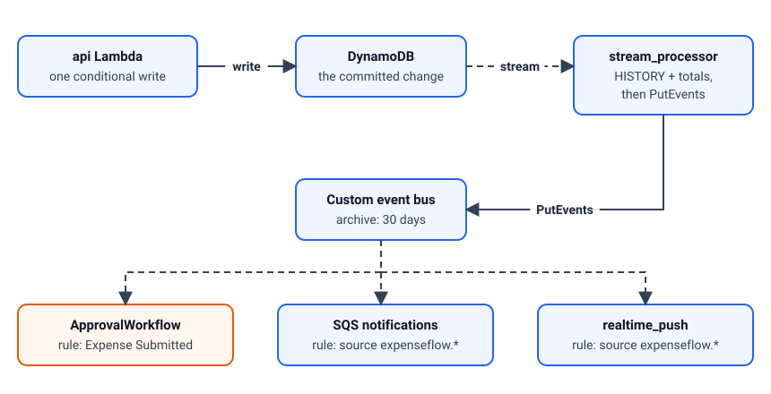

# Pattern 09: Events with EventBridge and a transactional outbox through the DynamoDB stream

Services: Amazon EventBridge (custom bus, rules, archive and replay), DynamoDB Streams, Lambda event source mapping, SQS dead-letter queues.

## Problem

When an expense is submitted, three things must follow: a workflow starts, people are notified, and open browsers update. The obvious code writes to the database **and** publishes an event in the same request. That is a *dual write*. If the process stops between the two calls, you get a saved expense without an event (nobody approves it), or an event without a saved expense. Retrying the whole request does not fix it.

## Pattern

The **transactional outbox**. Make exactly **one** write: the business change in the database. Derive the event from that committed change. DynamoDB Streams is a built-in outbox: it records every change in order per item and keeps it for 24 hours. A Lambda reads the stream and publishes events to **EventBridge**. EventBridge rules route each event to its consumers, and every consumer has its own retry and dead-letter queue.



Consequences you accept:

- Delivery is **at least once**. A record can be processed twice, so every step must be idempotent.
- Events are **eventually** published (milliseconds to seconds later), never lost.
- The producer (the API) knows nothing about consumers. A new consumer is a new rule.

## In ExpenseFlow

- The write: `ExpenseRepository.submit` in [`repository.py`](../../backend/src/expenseflow/repository.py). Its docstring explains that the stream turns this change into `Expense Submitted`.
- [`stream_processor.py`](../../backend/src/handlers/stream_processor.py):
  - `record_handler` compares the old and new image. A changed `status` (or an INSERT) goes through `_status_changed`. A finished extraction goes through `_receipt_processed`.
  - **Write first, publish second**: `history.record_status_change` writes the audit item (and totals), then `events.publish`. If publishing fails, the record is retried; the history write is skipped as a duplicate, and the event is published again.
  - Business metrics: `StatusTransitions` (dimension `to`), `ExpensesApproved`, `ExpensesRejected`, emitted only for changes recorded for the first time.
  - Powertools `BatchProcessor` and `process_partial_response` report only the failing records.
- [`events.py`](../../backend/src/expenseflow/events.py): `detail_type_for_transition` (for example `PENDING_APPROVAL` to `DRAFT` is `Expense Withdrawn`), `build_expense_detail` (every key always present, plus `idempotencyKey` = `<expenseId>:<status>:<updatedAt>`), `publish` (chunks of 10; `FailedEntryCount > 0` raises `EventPublishError`, so the record is retried).
- [`backend_stack.py`](../../infra/expenseflow_infra/stacks/backend_stack.py):
  - `_event_bus`: a **custom bus** with a 30-day **archive** of all `expenseflow.*` events (replayable).
  - `_stream_source` (`DynamoEventSource`): batch 25, retry 5 times, `bisect_batch_on_error`, max record age 1 hour, failures to the SQS `StreamDlq`, and a **server-side filter** (`INSERT` or `MODIFY`, key `EXPENSE#...` and `META`). The filter keeps the processor's own HISTORY and TOTAL writes from triggering it again.
  - `_route_events`: `ExpenseSubmittedRule` starts the ApprovalWorkflow (target DLQ `ApprovalRuleDlq`, 4 retries, max age 2 hours); `NotificationsRule` sends everything to SQS ([pattern 10](10-sqs-dlq-idempotency.md)); `RealtimeRule` invokes `realtime_push` ([pattern 11](11-websockets.md)). `ReceiptUploadedRule` listens on the *default* bus for S3 events.
- The event names (`source` and `detail-type`) are constants at the top of `events.py`: a contract between the rules, the archive and every consumer. Consumers list the types they know (`notify.py`, `realtime_push.py`) and ignore the rest.

## Same pattern in other industries

- **Retail**: "order placed" is written to the orders table; the stream publishes the event for payment, stock and e-mail. No lost orders when the event bus is down for a minute.
- **Banking**: a ledger entry triggers fraud scoring and statement updates, while the ledger write stays the only synchronous step.
- **IoT**: a device shadow update triggers alerts and dashboards without the device waiting for them.

## Hands-on

> Written from the code and the AWS documentation; not run against a real account by the author. Deploy first: [deploy guide](../expenseflow/deploy.md). Helper `Get-Output`: [pattern 01, Hands-on](01-cognito-auth.md#hands-on).

**Console**

1. **Amazon EventBridge > Buses > Event buses**: open the bus named in the output `EventBusName`.
2. **Rules**: `ExpenseSubmittedRule`, `NotificationsRule`, `RealtimeRule`. Open one and read the *Event pattern* and the *Targets* (retry policy, dead-letter queue).
3. **Archives**: the archive for this bus; note *Event count* and *Retention days* (30).
4. **DynamoDB > Tables > (table) > Exports and streams**: *DynamoDB stream details* with *New and old images*.
5. **Lambda > (function with `StreamProcessor` in its name) > Configuration > Triggers**: the DynamoDB trigger with batch size, retry attempts, bisect on error, on-failure destination and the filter criteria.
6. Submit an expense in the app. In **Under the hood > Live event log** you see the `Expense Submitted` event as the WebSocket message that `realtime_push` sent.

<!-- screenshot: EventBridge > Event buses > (bus) > Rules > ExpenseSubmittedRule > Targets -->
<!-- screenshot: Lambda > StreamProcessor > Configuration > Triggers > DynamoDB -->

**CLI (PowerShell)**

```powershell
$bus = Get-Output ExpenseFlow-Dev-Backend EventBusName
aws events list-rules --event-bus-name $bus --query "Rules[].{name:Name,state:State}" --output table
aws events list-archives --query "Archives[].{name:ArchiveName,days:RetentionDays,events:EventCount}" --output table
$fn = aws lambda list-functions --query "Functions[?contains(FunctionName,'StreamProcessor')].FunctionName" --output text
aws lambda list-event-source-mappings --function-name $fn `
  --query "EventSourceMappings[].{state:State,batch:BatchSize,bisect:BisectBatchOnFunctionError,retries:MaximumRetryAttempts,maxAge:MaximumRecordAgeInSeconds}" --output table
```

## Break it and fix it

**Experiment: replay events and prove the consumers are idempotent.**

1. Submit an expense and let it finish (approve it).
2. **EventBridge > Replays > Create replay**. Source: the bus archive. Time range: from a few minutes before your submission to now. Destination: the same bus. Under *Rules*, choose **only `ExpenseSubmittedRule`**. (Replaying to the notification rule would send the e-mails again, apart from the idempotency check below.)
3. Open the ApprovalWorkflow executions. A new execution appears and ends at `AlreadyHandled`: `ClaimExpense` requires `status = PENDING_APPROVAL AND attribute_not_exists(workflowExecutionArn)`.
4. Optional: also replay to `NotificationsRule` and read the notifier logs. Duplicates are skipped because the same `idempotencyKey` was already processed ([pattern 10](10-sqs-dlq-idempotency.md)).

**Lesson**: the bus can deliver the same event again (retry, replay, a producer retry). Safe consumers are idempotent. Replay is a recovery tool: after you fix a bug in a consumer you can re-feed the last 30 days. If your replay created a duplicate effect, find the consumer without a guard and add one.

## Your turn (one pull request)

Publish an `Expense Deleted` event when a draft is deleted.

- The stream filter only passes `INSERT` and `MODIFY`. Add `REMOVE` for the `EXPENSE#...` / `META` key in `_stream_source`.
- A `REMOVE` record has an **old image** and no new image. `record_handler` currently returns when there is no new image: add a branch that builds the event from the old image (`events.py`: new detail type and idempotency key such as `<id>:DELETED`).
- Check that `notify.recipients` and `realtime_push.audiences` ignore or handle the new type, and add tests in `backend/tests/test_stream_processor.py`.

## Interview questions

<details>
<summary>Show questions and short answers</summary>

1. **What problem does an outbox solve?**
   The dual write: a database change and an event that must both happen. With an outbox there is one write and the event is derived from it.
2. **Why is "at least once" acceptable?**
   Because consumers are idempotent. Exactly-once delivery across systems is not available, so you design for duplicates.
3. **EventBridge, SNS or SQS?**
   EventBridge for content-based routing and many targets (filter by `source` and `detail-type`). SNS for simple fan-out to many subscribers. SQS for a work queue with buffering and retries. Often combined, as here.
4. **What is the archive for?**
   To keep events for a time and replay them to the bus, for example after fixing a consumer.
5. **What does `bisect_batch_on_error` do?**
   When a batch fails, Lambda splits it in two and retries, which isolates the poison record faster. With partial batch responses and a DLQ, one bad record does not block the shard.
6. **Why filter the stream at the event source?**
   Filtered records do not invoke or bill the function, and it prevents the function's own writes from retriggering it.

</details>

Next: [Pattern 10, SQS, dead-letter queues and idempotency](10-sqs-dlq-idempotency.md).
