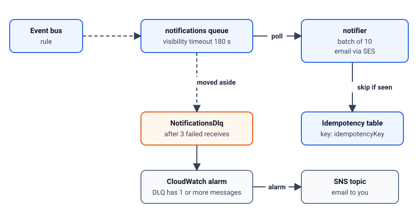

# Pattern 10: Queues, dead-letter queues and idempotent consumers

Services: Amazon SQS (standard queue, dead-letter queue, redrive), AWS Lambda event source mapping, Powertools batch and idempotency utilities, Amazon SES, CloudWatch alarms.

## Problem

E-mail sending is slow, can fail, and must not block the approval. Events arrive in bursts. The e-mail service may throttle. A message can be delivered twice. A broken message must not retry forever, and nobody should receive the same e-mail twice.

## Pattern

Put a **queue** between the event and the worker. The queue absorbs bursts and retries failed messages after a **visibility timeout**. After a fixed number of failed receives, SQS moves the message to a **dead-letter queue (DLQ)**. A CloudWatch **alarm** tells you the DLQ is not empty. The worker is **idempotent**: processing the same business event twice has the effect of once.



Three rules that make it work:

1. **Visibility timeout above the worker's timeout.** AWS advises at least six times the function timeout. The notifier runs up to 30 s, so the queue uses 180 s. Otherwise a slow batch is delivered again while it is still running.
2. **Partial batch response.** The worker returns only the ids of failed messages. SQS deletes the rest. Without this, one bad message redelivers its nine neighbours.
3. **Idempotency key from the business, not from the transport.** The SQS message id changes when a producer sends again. The key `<expenseId>:<status>:<updatedAt>` does not.

## In ExpenseFlow

- [`backend_stack.py`](../../infra/expenseflow_infra/stacks/backend_stack.py):
  - `_queues`: `NotificationsQueue` (visibility 180 s) with `NotificationsDlq` (`max_receive_count` 3, retention 14 days). Other DLQs (`StreamDlq`, `RealtimeDlq`, `ApprovalRuleDlq`, `ReceiptRuleDlq`, `SchedulerDlq`) are targets' failure destinations.
  - `_queue`: encrypted at rest (SSE-SQS) and refuses plain HTTP (`enforce_ssl`).
  - `_dead_letter_queue`: explains why cdk-nag rule SQS3 is acknowledged: the queue **is** a DLQ.
  - `_notifier`: `SqsEventSource(batch_size=10, max_batching_window=5 s, report_batch_item_failures=True)`.
- [`notifier.py`](../../backend/src/handlers/notifier.py):
  - `process_partial_response` with `BatchProcessor(EventType.SQS)`.
  - `IdempotencyConfig(event_key_jmespath="powertools_json(body).detail.idempotencyKey", expires_after_seconds=86400, raise_on_no_idempotency_key=True)`. A message without a key is malformed and fails into the DLQ.
  - `_idempotent_notify` builds the persistence layer lazily and caches it: one instance per config, no AWS client at import time.
  - `idempotency_config.register_lambda_context(context)`: if the invocation times out, the in-progress record can expire so the retry is not blocked.
  - With no `senderEmail` the notifier only logs `e-mail disabled (no SENDER_EMAIL): would have sent` and counts `NotificationsSkipped`.
- [`notify.py`](../../backend/src/expenseflow/notify.py): `recipients` (managers for submissions, the owner for decisions, admins for escalations and reports), `send` (SES v2). **SES sandbox**: a new account can send only to verified addresses. `MessageRejected` is logged, not raised. Throttling and 5xx **do** raise, so SQS retries.
- [`data_stack.py`](../../infra/expenseflow_infra/stacks/data_stack.py), `_idempotency_table`: partition key `id`, TTL attribute `expiration`, on-demand.
- [`monitoring.py`](../../infra/expenseflow_infra/constructs/monitoring.py): for every DLQ an alarm on `ApproximateNumberOfMessagesVisible >= 1`, with an SNS topic and optional e-mail (`-c alarmEmail=...`).

## Same pattern in other industries

- **Retail**: order-confirmation e-mails and SMS. A provider outage fills the queue, not the checkout.
- **Logistics**: scan events from handheld devices; poison messages (bad barcode format) end in a DLQ for support to review.
- **Payments**: a webhook consumer with an idempotency key per payment, because providers deliver the same webhook several times.

## Hands-on

> Written from the code and the AWS documentation; not run against a real account by the author. Deploy first: [deploy guide](../expenseflow/deploy.md). Helper `Get-Output`: [pattern 01, Hands-on](01-cognito-auth.md#hands-on). Without `-c senderEmail=...` no real e-mail is sent; the notifier writes what it would send to its log.

**Console**

1. **Simple Queue Service > Queues**: two queues with `NotificationsQueue` and `NotificationsDlq` in their names. Open the first: *Details* show visibility timeout 3 minutes, and the *Dead-letter queue* tab shows `maxReceiveCount` 3.
2. **Lambda triggers** tab: the notifier function, batch size 10, batching window 5 s, *Report batch item failures* on.
3. Submit an expense. Open the notifier's log group in **CloudWatch > Logs > Logs Insights**:

```
fields @timestamp, message, detail_type, to
| filter message like /would have sent/
| sort @timestamp desc
| limit 20
```

4. **DynamoDB > Tables**: open the idempotency table (name contains `Idempotency`). **Explore items**: one record per processed event key, with an `expiration` time 24 hours ahead.
5. **CloudWatch > Alarms**: find `NotificationsDlq...MessagesAlarm`, state *OK*.

<!-- screenshot: SQS > Queues > NotificationsQueue > Dead-letter queue tab -->
<!-- screenshot: DynamoDB > Idempotency table > Explore items -->

**CLI (PowerShell)**

```powershell
$q = aws sqs list-queues --queue-name-prefix ExpenseFlow-Dev-Backend --query "QueueUrls" --output text
$q -split "\s+"
aws dynamodb list-tables --query "TableNames[?contains(@, 'Idempotency')]" --output text
```

## Break it and fix it

**Experiment: a poison message.**

1. Put a message without an `idempotencyKey` on the queue:

```powershell
$url = (aws sqs list-queues --queue-name-prefix ExpenseFlow-Dev-Backend --query "QueueUrls[?contains(@, 'NotificationsQueue')]" --output text)
'{"hello":"world"}' | Set-Content poison.json -Encoding ascii
aws sqs send-message --queue-url $url --message-body file://poison.json
```

2. The notifier fails that message (no key) and reports it as a batch item failure. SQS shows it again after the visibility timeout (3 minutes). After the third receive (about 6 to 10 minutes) it moves to `NotificationsDlq`.
3. In the console open the DLQ and **Poll for messages**: your message is there. The alarm switches to *In alarm* within a few minutes, and sends an e-mail if you configured `alarmEmail` and confirmed the SNS subscription.

**Fix**: read the message, decide it is garbage, and delete it (**Purge**) or, for a real message after you fixed the bug, choose **Start DLQ redrive** to send it back to the source queue. Idempotency makes the redrive safe: messages that were processed meanwhile are skipped.

## Your turn (one pull request)

Alarm when the work queue **backs up**: `ApproximateAgeOfOldestMessage` of the notifications queue at 300 seconds or more.

- `Monitoring` already receives `work_queues` (used for dashboard widgets). Add an alarm per work queue in `monitoring.py` (`queue.metric_approximate_age_of_oldest_message`).
- Add a test in `infra/tests/test_backend_stack.py` and keep the real `cdk synth` with cdk-nag green.
- In the PR description: why is the age of the oldest message a better signal than the number of messages?

## Interview questions

<details>
<summary>Show questions and short answers</summary>

1. **How does SQS give you retries?**
   A received message becomes invisible for the visibility timeout. If it is not deleted in time, it becomes visible again. After `maxReceiveCount` receives, it goes to the DLQ.
2. **Standard or FIFO queue?**
   Standard: nearly unlimited throughput, at-least-once, no strict order. FIFO: exactly-once processing within a deduplication window and order per message group, lower throughput. Here order does not matter and idempotency covers duplicates.
3. **Why a partial batch response?**
   One failed record should not redeliver the others, which would cause duplicate side effects and wasted work.
4. **What makes a good idempotency key?**
   A value that is the same for every attempt of the same business operation: here the state change (`expenseId`, status, `updatedAt`).
5. **What do you do with a DLQ message?**
   Investigate, fix the cause, then redrive or delete. An alarm on the DLQ makes sure someone looks.
6. **Why a queue and not call SES directly from the stream processor?**
   Isolation: a slow or throttled e-mail service must not delay approvals or block the shard. The queue also gives retries and a DLQ for free.

</details>

Next: [Pattern 11, WebSockets for live updates](11-websockets.md).
