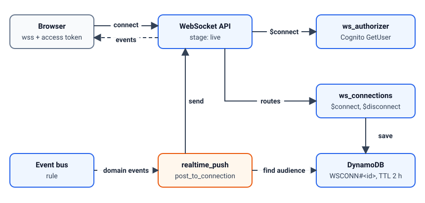
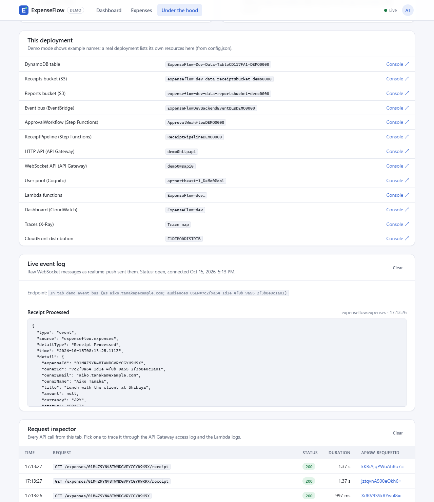

# Pattern 11: Live updates with API Gateway WebSockets

Services: API Gateway WebSocket API, Lambda authorizer, Lambda, DynamoDB (with TTL), EventBridge.

## Problem

A manager should see a new submission without reloading. An employee should see "Claude read your receipt" the moment it is done. Polling the API every few seconds wastes calls and still feels slow. The server must be able to **push** to browsers, and only to the right people.

## Pattern

A **WebSocket API** keeps one open connection per browser tab. API Gateway owns the connections. Your code runs only on events: connect, disconnect, and when you decide to push.



How it works here:

1. The browser opens `wss://.../live?token=<access token>`. Browsers cannot set headers on a WebSocket handshake, so the token travels in the query string.
2. A **Lambda authorizer** runs on `$connect` only. After that, every frame rides on the accepted connection.
3. `ws_connections` stores the connection in DynamoDB, once per **audience** (`USER#<id>`, plus `GROUP#managers` or `GROUP#admins`), with a **TTL**.
4. A domain event reaches `realtime_push`. It looks up the connections of the event's audiences and calls `post_to_connection` for each.
5. A closed connection answers **410 Gone**. The function deletes it and moves on.

## In ExpenseFlow

- [`realtime_api.py`](../../infra/expenseflow_infra/constructs/realtime_api.py), class `RealtimeApi`: authorizer on `$connect` with identity source `route.request.querystring.token`, routes `$connect`, `$disconnect`, `$default`, stage `live` (throttle rate 50, burst 100), access logs through the L1 `CfnStage` escape hatch. `_account_logging_role` creates the **account-level** API Gateway CloudWatch role (`CfnAccount`) and keeps it when the stack is deleted. If your account already has such a role for other APIs, check **API Gateway > Settings** before deploying: this stack points the setting at its own role.
- [`ws_authorizer.py`](../../backend/src/handlers/ws_authorizer.py): calls Cognito `GetUser` with the token, **unsigned** (the token is the credential, so the function needs no IAM permission). `GetUser` accepts access tokens of any pool and client, so the function then decodes the payload and checks `token_use == "access"`, `client_id` and `iss`. Any failure raises `Exception("Unauthorized")`, which API Gateway turns into **401**.
- [`ws_connections.py`](../../backend/src/handlers/ws_connections.py): one function for the three routes, dispatching on `requestContext.routeKey`. `$default` accepts anything (the app sends `{"action":"ping"}`).
- [`connections.py`](../../backend/src/expenseflow/connections.py): `audiences_for`, `register` (items `PK=WSCONN#<id>`, `SK=AUD#<audience>`, `GSI1PK=WSAUD#<audience>`, `expiresAt` = now plus 2 h 5 min; TTL needs epoch **seconds**), `unregister`, `connection_ids` (queries GSI1 and filters expired items: TTL deletion can lag by a day, so correctness must not depend on it).
- [`realtime_push.py`](../../backend/src/handlers/realtime_push.py): `audiences` (always the owner; submitted and withdrawn also `GROUP#managers`; escalated also managers and admins; report generated admins), `message` (`{"type":"event","source","detailType","time","detail"}`), `push` (counts `delivered`, `gone`, `failed`; one bad connection never blocks the others).
- Browser: [`socket.ts`](../../frontend/src/live/socket.ts) (token read fresh on each connect, ping every 5 minutes, reconnect with backoff; API Gateway closes idle connections after 10 minutes and every connection after 2 hours), [`LiveEventsProvider.tsx`](../../frontend/src/live/LiveEventsProvider.tsx), [`LiveToasts.tsx`](../../frontend/src/app/LiveToasts.tsx), and the *Live event log* on the *Under the hood* page.

## Same pattern in other industries

- **Trading or auctions**: price and bid updates to everyone watching one item (audience = the item).
- **Logistics**: a dispatcher's map updates as drivers' vehicles report (audience = a depot).
- **Customer support**: a chat message pushed to the one agent assigned to the ticket.

## Hands-on

> Written from the code and the AWS documentation; not run against a real account by the author. Deploy first: [deploy guide](../expenseflow/deploy.md). Helper `Get-Output` and sign-in: [pattern 01, Hands-on](01-cognito-auth.md#hands-on).

**Console**

1. **API Gateway > APIs**: open the WebSocket API (the output `WebSocketApiId`).
2. **Routes**: `$connect` (with the Lambda authorizer), `$disconnect`, `$default`.
3. **Stages > live**: *WebSocket URL* (`wss://...`) and *Connection URL* (used by `post_to_connection`).
4. In the app open **Under the hood > Live event log**: status *open*. Do something in a second tab (submit an expense): the raw message appears.
5. **DynamoDB > (table) > Explore items > Query**: index `GSI1`, partition key `WSAUD#USER#<your user id>` (your `sub`, see pattern 01). One item per open tab.

<!-- screenshot: API Gateway > WebSocket API > Routes -->
<!-- screenshot: DynamoDB > (table) > Explore items > GSI1 > WSAUD#USER#<id> -->

**CLI (PowerShell)**

```powershell
$ws = Get-Output ExpenseFlow-Dev-Backend WebSocketUrl
$apiId = Get-Output ExpenseFlow-Dev-Backend WebSocketApiId
aws apigatewayv2 get-routes --api-id $apiId --query "Items[].{route:RouteKey,auth:AuthorizationType}" --output table

# An ACCESS token (not the ID token) is needed for the socket:
$pool = Get-Output ExpenseFlow-Dev-Auth UserPoolId; $client = Get-Output ExpenseFlow-Dev-Auth UserPoolClientId
$env:ACCESS_TOKEN = aws cognito-idp admin-initiate-auth --user-pool-id $pool --client-id $client `
  --auth-flow ADMIN_USER_PASSWORD_AUTH --auth-parameters "USERNAME=you@example.com,PASSWORD=<your password>" `
  --query "AuthenticationResult.AccessToken" --output text

# Optional: wscat is a third-party npm tool; npx downloads it.
npx wscat -c "${ws}?token=$env:ACCESS_TOKEN"
```

Keep `wscat` open and submit an expense in the app (as the same user, or as manager while this user is a manager). The JSON frame arrives in your terminal.

## Break it and fix it

**Experiment: connect with the wrong token.**

```powershell
npx wscat -c "${ws}?token=not-a-token"                 # error: Unexpected server response: 401
npx wscat -c "${ws}?token=$env:ID_TOKEN"               # 401 too: the ID token is not an access token
```

Both fail on `$connect` before any of your connection code runs. The browser shows a refused WebSocket as a bare close without a reason, so in the app it looks like a network error; that is why `socket.ts` uses backoff. Fix: use a fresh **access** token.

**Second experiment (optional)**: leave `wscat` open for more than 10 minutes without typing. API Gateway closes the idle connection. The app avoids this with its ping every 5 minutes. The stale item in DynamoDB disappears through `$disconnect`, through a 410 on the next push, or at the latest by TTL.



## Your turn (one pull request)

Let **admins** watch rejections live: also push `Expense Rejected` to `GROUP#admins`.

- Add the audience in `_GROUP_AUDIENCES` of `realtime_push.py`.
- Add a test case to `backend/tests/test_realtime_push.py` (see how the other audiences are tested).
- Decide: should the browser toast it? If yes, extend `toastFor` in `LiveToasts.tsx` for admins.

## Interview questions

<details>
<summary>Show questions and short answers</summary>

1. **WebSocket, Server-Sent Events or polling?**
   WebSocket is two-way and good for frequent pushes. SSE is one-way over HTTP and simpler. Polling is simplest but wasteful and slow. For rare, one-way updates, polling or SSE can be enough.
2. **Why is the authorizer only on `$connect`?**
   API Gateway authorizes the handshake. Later messages ride on the accepted connection, so you do not authorize every frame.
3. **Why store connections in a table?**
   Lambda is stateless and API Gateway owns the sockets. You need a map from "who should get this" to connection ids. TTL cleans connections that never said goodbye.
4. **What is a 410 Gone on `post_to_connection`?**
   The client is no longer connected. Delete the stored connection.
5. **Why is the token in the query string a concern?**
   URLs can appear in logs. Use short-lived access tokens (1 hour here), never log the query string, and keep the token's scope small.
6. **How does it scale?**
   One `post_to_connection` call per recipient connection. For very large fan-out use a service built for it (for example AWS IoT Core or AppSync subscriptions).

</details>

Next: [Pattern 12, Scheduled jobs with EventBridge Scheduler](12-scheduler-jobs.md).
