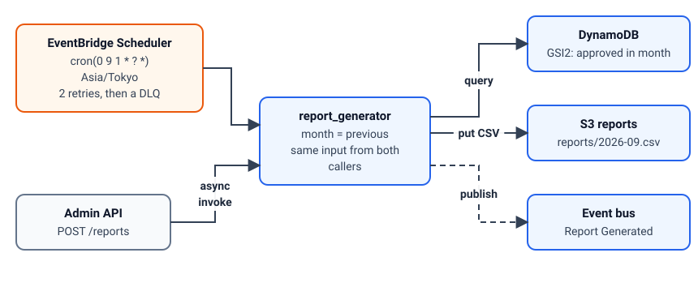

# Pattern 12: Scheduled jobs with EventBridge Scheduler

Services: Amazon EventBridge Scheduler, AWS Lambda, Amazon S3, DynamoDB (GSI query), EventBridge custom bus.

## Problem

On the first of every month at 09:00 Tokyo time, finance wants a CSV of last month's approved expenses. Nobody should have to remember it. The job should also be startable by hand for any month, safe to run twice, and visible when it fails.

## Pattern

A **schedule** invokes a target on a time rule. **EventBridge Scheduler** is the purpose-built service: it understands **time zones**, retries failed deliveries, can send failures to a **dead-letter queue**, and calls Lambda directly. The job is written so that "run again" is harmless (**idempotent**): the report key depends only on the month, so a second run overwrites the first with the same content.



Why Scheduler and not a classic EventBridge rule with a cron: rules know only UTC. Scheduler evaluates the expression in the zone you name, so "09:00 in Tokyo" stays 09:00 in Tokyo. (Japan has no daylight saving; in other countries this matters twice a year.) Scheduler also supports one-time schedules and flexible time windows.

## In ExpenseFlow

- [`backend_stack.py`](../../infra/expenseflow_infra/stacks/backend_stack.py), `_report_generator`:
  - `scheduler.Schedule` with `ScheduleExpression.cron(minute="0", hour="9", day="1", time_zone=TimeZone.ASIA_TOKYO)`;
  - target `scheduler_targets.LambdaInvoke` with input `{"month": "previous", "requestedBy": "scheduler"}`, `retry_attempts=2`, `dead_letter_queue=SchedulerDlq`;
  - the function: 300 s timeout, 1024 MB, reads the table, writes only under `reports/`, may put events on the bus;
  - the role CDK creates for the Scheduler target has a version-qualified wildcard (`function-arn:*`), acknowledged in cdk-nag with a reason.
- [`report_generator.py`](../../backend/src/handlers/report_generator.py): one input shape for two callers. `generate` builds the report, stores it, publishes `Report Generated` (see [pattern 09](09-eventbridge-outbox.md)). `handler` treats a missing month as `"previous"`, so a console test with `{}` works.
- [`reports.py`](../../backend/src/expenseflow/reports.py):
  - `resolve_month`: `"previous"` is the previous calendar month **in Japan**; otherwise `YYYY-MM` is required (`ValueError` otherwise);
  - `build_report`: CSV with CRLF line ends, written as **UTF-8 with BOM** (`utf-8-sig`), because Excel on Japanese Windows otherwise guesses Shift_JIS and breaks Japanese text. Cells that start with `=`, `+`, `-` or `@` get a leading apostrophe (protection against **CSV formula injection**: a merchant called `=HYPERLINK(...)` must not run in Excel);
  - `store` writes `reports/<yyyy-mm>.csv`.
- [`repository.py`](../../backend/src/expenseflow/repository.py), `iter_approved_in_month`: `Query GSI2 STATUS#APPROVED AND begins_with(GSI2SK, "2026-09-")`. APPROVED is terminal, so the GSI2 sort key time is the approval time ([pattern 03](03-dynamodb-single-table.md)).
- [`routes_reports.py`](../../backend/src/handlers/api/routes_reports.py): `POST /reports` (admins) invokes the same function **asynchronously** and answers 202; `GET /reports` lists files; `GET /reports/{month}` returns a presigned download URL. UI: [`ReportsPage.tsx`](../../frontend/src/pages/ReportsPage.tsx).

## Same pattern in other industries

- **Retail**: nightly stock reconciliation at 02:00 local store time.
- **Telecom**: monthly billing run on the 1st, with a manual "re-run for one customer" path.
- **Education**: a weekly digest e-mail on Friday 16:00 school time, one schedule per school time zone.

## Hands-on

> Written from the code and the AWS documentation; not run against a real account by the author. Deploy first: [deploy guide](../expenseflow/deploy.md). Helper `Get-Output`: [pattern 01, Hands-on](01-cognito-auth.md#hands-on). You need an admin account (`python scripts/add_user_to_group.py --email you@example.com --group admins`).

**Console**

1. **Amazon EventBridge > Scheduler > Schedules**: the schedule whose name contains `MonthlyReportSchedule`. Check the *Schedule expression* (`cron(0 9 1 * ? *)`), the *Time zone* (`Asia/Tokyo`), the *Target* (Lambda `Invoke` with your JSON input), the *Retry policy* and the *Dead-letter queue*.
2. In the app, as admin open **Reports**, pick last month and **Generate**. The *Report Generated* event arrives live. Download the CSV and open it in Excel.
3. **S3 > (reports bucket) > reports/**: `2026-09.csv` (your month). Generate the same month again: *Last modified* changes, there is still one object.

<!-- screenshot: EventBridge > Scheduler > Schedules > MonthlyReportSchedule > Details -->
<!-- screenshot: S3 > (reports bucket) > reports/ -->

**CLI (PowerShell)**

```powershell
aws scheduler list-schedules --query "Schedules[].{name:Name,state:State}" --output table
$fn = aws lambda list-functions --query "Functions[?contains(FunctionName,'ReportGenerator')].FunctionName" --output text
'{"month":"2026-09","requestedBy":"lab"}' | Set-Content event.json -Encoding ascii
aws lambda invoke --function-name $fn --payload fileb://event.json out.json
Get-Content out.json                                   # {"month":..., "key":..., "rowCount":..., "totals":{...}}
$bucket = Get-Output ExpenseFlow-Dev-Data ReportsBucketName
aws s3 cp "s3://$bucket/reports/2026-09.csv" .
```

Send `{}` as the payload to see `"previous"`, the month the schedule would use today.

## Break it and fix it

**Experiment 1: an invalid month.**

```powershell
'{"month":"2026-13","requestedBy":"lab"}' | Set-Content bad.json -Encoding ascii
aws lambda invoke --function-name $fn --payload fileb://bad.json out.json
Get-Content out.json
```

The invoke call itself succeeds (HTTP 200) but the response has `FunctionError: Unhandled` and `errorType: ValueError` with the message `month must be "YYYY-MM" or "previous"`. Within about five minutes the alarm for the function's `Errors` metric changes to *In alarm* ([pattern 13](13-observability.md)). Fix: send a valid month. Through the API, the same input is stopped earlier, with a 422.

**Experiment 2: a month without approvals.** Generate a month with no data (for example `2020-01`). You get a CSV with only the header row, `rowCount` 0. A job that finds nothing is a valid result.

**Lesson**: Scheduler retries and the DLQ cover failures to *deliver* the invocation (for example throttling). A bug **inside** the function is a Lambda error, found by the error alarm and the logs. Design both layers.

## Your turn (one pull request)

Make the schedule testable: add context options `-c reportDay=1` and `-c reportHour=9`.

- Parse and validate them in `config.py` (see `monthlyBudgetUsd` for `ctx.integer(...)` with minimum and maximum), store them in `StageConfig`.
- Use them in `_report_generator` (`day` 1 to 28, `hour` 0 to 23).
- Add tests in `infra/tests/test_config.py` and `test_backend_stack.py`.

Acceptance: `-c reportDay=15 -c reportHour=18` changes the synthesized cron to `cron(0 18 15 * ? *)`.

## Interview questions

<details>
<summary>Show questions and short answers</summary>

1. **EventBridge Scheduler or an EventBridge rule with a cron?**
   Scheduler: time zones, one-time schedules, per-schedule retry and DLQ, flexible windows, millions of schedules. Rules: UTC only, but simple and also match events.
2. **Read this expression: `cron(0 9 1 * ? *)`.**
   Minute 0, hour 9, day-of-month 1, every month, any day-of-week, every year. Six fields.
3. **How do you make a scheduled job idempotent?**
   Derive the output location and content from the input (month), write with overwrite, and use conditional writes for side effects. Here the CSV key is `reports/<month>.csv`.
4. **What if the job needs more than 15 minutes?**
   A Lambda function cannot run that long. Use Step Functions, Fargate or AWS Batch and let the schedule start them.
5. **What is CSV injection?**
   A cell starting with `=`, `+`, `-` or `@` can be run as a formula by a spreadsheet. Prefix such cells so they stay text.
6. **Why a BOM in the CSV?**
   Excel on Japanese Windows reads a BOM-less CSV as Shift_JIS. The BOM tells it the file is UTF-8.

</details>

Next: [Pattern 13, Observability](13-observability.md).
