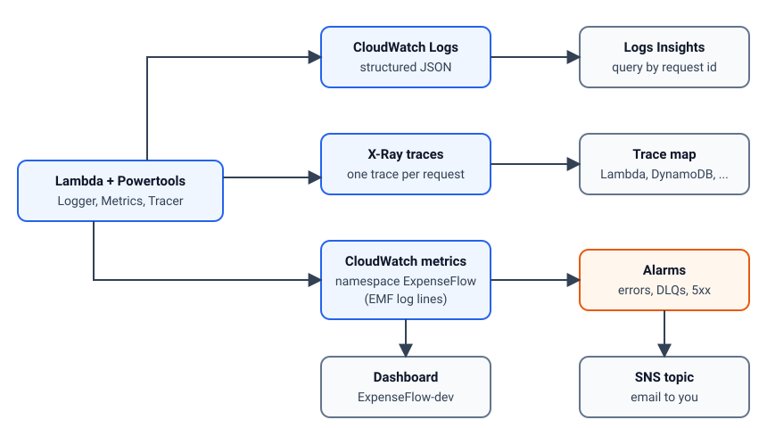
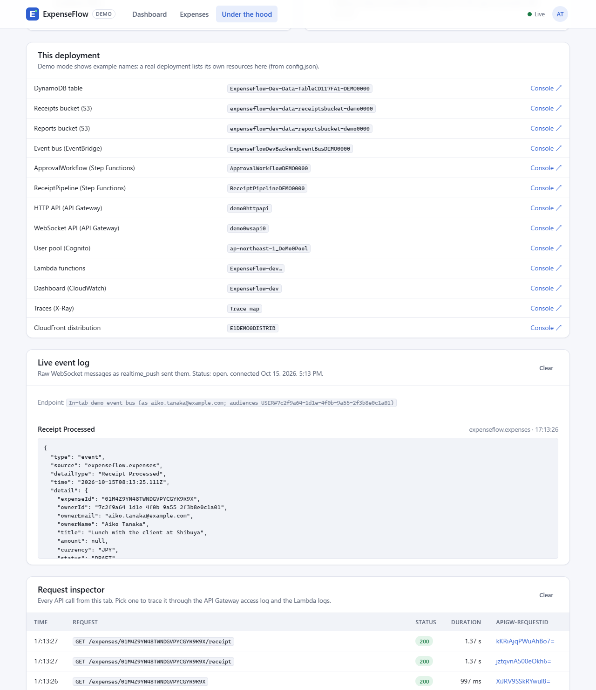

# Pattern 13: Observability with logs, metrics, traces and alarms

Services: Amazon CloudWatch (Logs, Logs Insights, Metrics, Dashboards, Alarms), AWS X-Ray, Amazon SNS, Powertools for AWS Lambda.

## Problem

In a distributed app one user action touches API Gateway, a Lambda, DynamoDB, a stream, EventBridge, a workflow and a queue. When something breaks at 3 a.m., "look at the server" does not exist. You need to answer three questions quickly: **Is something wrong?** (alarm), **Where?** (trace and metrics), **Why?** (logs with a request id).

## Pattern

Use the three signals, and connect them:

- **Logs**: structured JSON lines, one event each, searchable with Logs Insights.
- **Metrics**: numbers over time. Platform metrics (invocations, errors, queue depth) are free. **Custom business metrics** (expenses approved, tokens used) are written as log lines in the Embedded Metric Format (EMF), and CloudWatch turns them into metrics without an API call.
- **Traces**: one request followed across services (X-Ray).
- **Alarms** watch the few metrics that mean "a person must look", and notify an **SNS topic** (e-mail).
- A **correlation id** (the API Gateway request id) is in the API access log, in every Lambda log line of that request, and in the response header. It ties the signals together.



## In ExpenseFlow

- [`python_function.py`](../../infra/expenseflow_infra/constructs/python_function.py): every Lambda gets JSON logging with Lambda-side level filtering (`INFO` for the app, `WARN` for platform lines), an **explicit log group** with retention (otherwise `/aws/lambda/<name>` never expires and survives `cdk destroy`), X-Ray `Tracing.ACTIVE`, and `POWERTOOLS_SERVICE_NAME` / `POWERTOOLS_METRICS_NAMESPACE=ExpenseFlow`.
- Powertools in the handlers: [`app.py`](../../backend/src/handlers/api/app.py) shows the decorator order (Logger outermost, `log_metrics` innermost) and why `clear_state=True` matters: a warm container must not log the previous caller's `user_id`. Events and responses are **not** logged or traced (JWT claims, presigned URLs, task tokens).
- Custom metrics (namespace `ExpenseFlow`): `ExpenseCreated`, `ExpenseSubmitted`, `ReceiptUploadRequested`, `ApprovalDecision` (dimension `decision`), `StatusTransitions` (dimension `to`), `ExpensesApproved`, `ExpensesRejected`, `NotificationsSent`, `NotificationsSkipped`, and the four `Extraction*` metrics with dimension `Model` ([pattern 06](06-bedrock-ai-extraction.md)). Keep dimensions to a few known values: every new combination is a new billable metric.
- [`http_api.py`](../../infra/expenseflow_infra/constructs/http_api.py): the access-log format includes `requestId`, `routeKey`, `status`, `latencyMs`, `integrationLatencyMs`, `userId`.
- [`monitoring.py`](../../infra/expenseflow_infra/constructs/monitoring.py), class `Monitoring`:
  - SNS `AlarmTopic` (TLS only), e-mail subscription with `-c alarmEmail=you@example.com` (AWS mails a confirmation link first);
  - alarms: API 5xx at 5 or more in 5 minutes; every Backend Lambda `Errors` at 1 or more; every DLQ with 1 or more visible message; every state machine `ExecutionsFailed` at 1 or more;
  - `TreatMissingData.NOT_BREACHING`: AWS publishes most metrics only when something happens, and "no data" must mean "fine";
  - dashboard `ExpenseFlow-<stage>`: API, Lambda errors and duration, Step Functions, SQS and DLQs, DynamoDB, business metrics, token usage, alarm status. The cost comment: an alarm is about US$0.10 per month beyond the first 10; a dashboard US$3 beyond the first 3.
- Step Functions: both machines log at level `ALL` with execution data and have tracing on ([`approval_workflow.py`](../../infra/expenseflow_infra/constructs/approval_workflow.py), `jsonata_state_machine`). Execution data can contain business data: size retention to your policy.
- Browser: [`console.ts`](../../frontend/src/lib/console.ts) builds deep links to the dashboard, alarms, Logs Insights and the trace map. The *Request inspector* on *Under the hood* lists each API call with its `apigw-requestid` and offers a ready Logs Insights query. HTTP APIs do not send X-Ray segments of their own, so a trace starts at the Lambda function; the trace map still shows Lambda calling DynamoDB, EventBridge, Step Functions and others.

## Same pattern in other industries

- **Payments**: alarms on error rate and p99 latency; a transaction id as correlation id across ten services.
- **Hospital systems**: audit logs (who read which record) kept for years, separate from short-retention debug logs.
- **Gaming**: custom metrics for matchmaking time and queue length; alarms page the on-call engineer.

## Hands-on

> Written from the code and the AWS documentation; not run against a real account by the author. Deploy first: [deploy guide](../expenseflow/deploy.md). Helper `Get-Output`: [pattern 01, Hands-on](01-cognito-auth.md#hands-on). AWS renames console menus from time to time; use the service search box if a path differs.

**Console**

1. **CloudWatch > Dashboards > `ExpenseFlow-dev`**: scroll through API, Lambda, workflows, queues, DynamoDB and business metrics. Use the app a little and refresh.
2. **CloudWatch > Alarms > All alarms**: one alarm per Lambda, per DLQ, per state machine, plus the API 5xx alarm. All should be *OK*.
3. **CloudWatch > Logs > Logs Insights**: in the app open **Under the hood > Request inspector**, copy the `apigw-requestid` of one call. In Logs Insights select **both** the API access log group (name contains `AccessLogs`) and the log group of the API function, then run:

```
fields @timestamp, @log, message, level, routeKey, status, user_id
| filter correlation_id = "<paste the request id>" or requestId = "<paste the request id>"
| sort @timestamp asc
```

4. **CloudWatch > Metrics > All metrics > ExpenseFlow**: graph `ExpenseSubmitted` (Sum) after submitting an expense.
5. **CloudWatch > Application Signals > Traces** or **X-Ray traces > Trace Map** (menu name varies): find the service map. Open a trace of `extract_receipt` to see time spent in Bedrock.
6. **Amazon SNS > Topics**: the alarm topic and its e-mail subscription (status *Confirmed* after you click the link).

<!-- screenshot: CloudWatch > Dashboards > ExpenseFlow-dev -->
<!-- screenshot: CloudWatch > Logs Insights > one request across two log groups -->
<!-- screenshot: CloudWatch > X-Ray traces > Trace map -->

**CLI (PowerShell)**

```powershell
aws cloudwatch describe-alarms --alarm-name-prefix ExpenseFlow-Dev-Backend `
  --query "MetricAlarms[].{name:AlarmName,state:StateValue}" --output table
aws cloudwatch list-metrics --namespace ExpenseFlow --query "Metrics[].MetricName" --output text
```

## Break it and fix it

**Experiment: trigger an alarm on purpose, safely.** Invoke a function with an input it cannot handle:

```powershell
$fn = aws lambda list-functions --query "Functions[?contains(FunctionName,'ApprovalRequestFunction')].FunctionName" --output text
'{}' | Set-Content empty.json -Encoding ascii
aws lambda invoke --function-name $fn --payload fileb://empty.json out.json
Get-Content out.json
```

The function needs `event["expenseId"]`, so it fails with a `KeyError`. Observe, in order:

1. The CLI output has `FunctionError: Unhandled`.
2. The function's log group has an error with a stack trace (Powertools JSON).
3. After up to five minutes the alarm for this function's `Errors` metric changes to **In alarm** and, with a confirmed subscription, you get an e-mail.
4. The next five-minute period has no errors: the alarm returns to **OK** by itself (missing data is "not breaching").

Nothing to fix; the lesson is the path from symptom to cause: alarm, dashboard widget, log group, stack trace. Remove `empty.json` and `out.json`.



## Your turn (one pull request)

Add a dashboard widget that shows the **20 slowest API requests** of the last hour.

- Give `Monitoring` the API access log group (`ExpenseHttpApi.access_logs`) and add a `cloudwatch.LogQueryWidget` with a query such as `fields @timestamp, routeKey, status, latencyMs | sort latencyMs desc | limit 20`.
- Pass the log group in `backend_stack.py`; update `infra/tests/test_backend_stack.py` to check the widget exists.
- In the PR description: which one number would you alarm on instead, and why a p99 latency alarm needs enough traffic to be useful?

## Interview questions

<details>
<summary>Show questions and short answers</summary>

1. **Logs, metrics and traces: when do you use which?**
   Metrics tell you that something is wrong and how much (cheap, aggregated). Traces show where time is spent across services. Logs explain why (details of one event). Alarms start from metrics.
2. **What is EMF?**
   Embedded Metric Format: a JSON log line with a metrics section. CloudWatch extracts the metrics. It avoids a `PutMetricData` API call (and its latency) per metric.
3. **What is a correlation id?**
   An id carried through every log line and call of one request. With it you reconstruct one story from many log groups.
4. **Why `TreatMissingData=NOT_BREACHING`?**
   Many metrics have no data points when nothing happens. Without it a quiet system would show *Insufficient data* instead of *OK*.
5. **How do you keep observability costs under control?**
   Log retention per environment, no giant payloads in logs, few metric dimensions, alarms only on actionable signals, sampling for traces.
6. **Why not log the full event in the API function?**
   It contains JWT claims and request bodies (personal data). Logs are readable by many people and live long. Log identifiers, not data.

</details>

This was the last pattern. Back to the [course map](../README.md).
