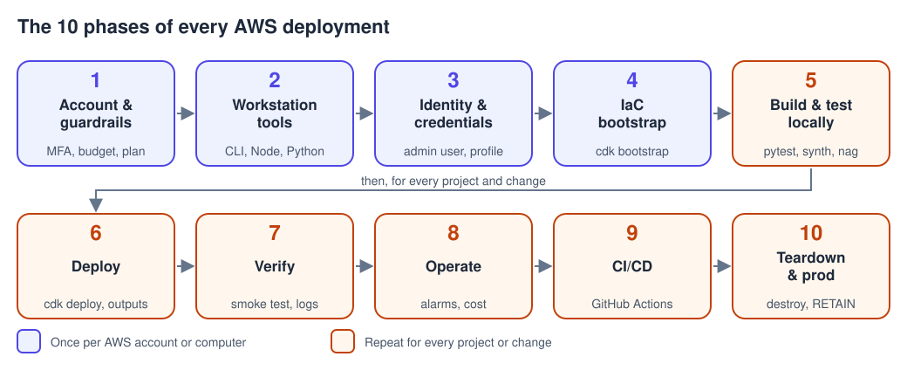

# Playbook overview: the 10 phases

This playbook is the order of work for **every app you deploy on AWS**. First do X, then install Y, then Z.
ExpenseFlow is the worked example: each step has an **In ExpenseFlow:** line with the real command or file.

## Goal

Know what to do, in which order, on any new AWS project. After your first project, the second one is a checklist, not a research task.

## Why

AWS has hundreds of services, but the *process* around them is always the same: a safe account, the right tools, a named identity, a bootstrapped environment, tests, a deploy, a check, and a way to clean up. People who skip a phase find out later, usually through a surprise bill or a half-deleted stack.

## The phases

| # | Phase | You do | How often | Page |
|---|---|---|---|---|
| 1 | Account and guardrails | root MFA, budget alert, plan, Region | once per AWS account | [01](01-account-guardrails.md) |
| 2 | Workstation tools | Git, Python, Node, AWS CLI | once per computer | [02](02-workstation-tools.md) |
| 3 | Identity and credentials | admin user, `aws login`, profile | once per person and computer | [03](03-identity-credentials.md) |
| 4 | IaC bootstrap | `cdk bootstrap`, environments, stages | once per account and Region | [04](04-iac-bootstrap.md) |
| 5 | Build and test locally | install dependencies, tests, `cdk synth` | every change | [05](05-build-test-locally.md) |
| 6 | Deploy | `cdk deploy`, read the outputs | every release | [06](06-deploy.md) |
| 7 | Verify | smoke test, logs, traces, metrics | every release | [07](07-verify.md) |
| 8 | Operate | alarms, dashboards, cost, backups | continuously | [08](08-operate.md) |
| 9 | CI/CD | GitHub Actions with OIDC (no stored keys) | once per repository | [09](09-cicd.md) |
| 10 | Teardown and prod | `cdk destroy`, retention, going live | end of life, and before real users | [10](10-teardown-prod.md) |

## Honest limits

- Nothing in these docs was deployed to a real AWS account from the machine that wrote them. The application code has automated tests, and the infrastructure code is synthesized with the real CDK and checked by cdk-nag. The AWS commands were written from the AWS and tool documentation. **Your first real deployment is the first real test.** If a step is wrong, fix the doc in a pull request. That is a good first lesson.
- AWS changes its sign-up flow, console and free plan often. Where this playbook states a number or a rule that may change, it says so.
- Cost numbers are estimates. Your bill is the truth: check [phase 8](08-operate.md).

## Exact steps

### 1. Read the phases once

Look at the diagram and the table above. Phases 1 to 4 prepare you and the account (indigo). Phases 5 to 10 repeat for every project or change (orange).

**In ExpenseFlow:** the same ten phases appear, in the same order, in the [ExpenseFlow deploy guide](../expenseflow/deploy.md).

### 2. First project: do the pages in order

Open each page and do its **Exact steps**. Every page has the same layout:

| Part | Meaning |
|---|---|
| Goal | What you have at the end. |
| Why | Why the phase exists. |
| Exact steps | Numbered. Each step has an **In ExpenseFlow:** line. |
| ✅ Verify | A command or screen that proves the step worked. |
| ⚠️ Common errors | The messages you will probably meet, and the fix. |
| 🔁 Repeat for every project | A short checklist for the next project. |

**In ExpenseFlow:** start with [phase 1](01-account-guardrails.md), and use the [deploy guide](../expenseflow/deploy.md) as the single page that collects all the commands.

### 3. Every later project: use the checklists

Skip the explanations and run the **Repeat for every project** checklist at the end of each page. The master list is at the end of this page.

**In ExpenseFlow:** copy the master list into the first GitHub issue of your next project.

### 4. Look up the building blocks when you need them

The playbook is about the process. The [patterns](../patterns/01-cognito-auth.md) are about the services: why API Gateway, why a Step Functions task token, why a dead-letter queue.

**In ExpenseFlow:** each pattern page points to the exact code and ends with an exercise.

### Conventions

- Commands are for **Windows PowerShell**. Bash equivalents are given only where they differ.
- `<angle brackets>` mean "put your own value here". `$account` holds your 12-digit account ID, and `$env:AWS_PROFILE` and `$env:AWS_REGION` choose the identity and Region. You set them once per terminal in [phase 3](03-identity-credentials.md).
- Console click paths look like **Service > Page > Button**. AWS renames menus now and then. If a name does not match, use the console search box at the top.
- Places where you can add your own console screenshot are marked with an HTML comment such as `<!-- screenshot: ... -->`. It is not visible when rendered.

## ✅ Verify

You are ready to start a project when you can answer these without looking:

- Which phases do I do once, and which ones for every project?
- What is the command that shows who I am to AWS?
- What is the command that removes everything the project created?

## ⚠️ Common errors

| Mistake | What happens | Fix |
|---|---|---|
| Skipping phase 1 (budget, root MFA) | A forgotten resource or a stolen password becomes a bill | Do it first, it takes 20 minutes |
| Using root or long-lived keys for daily work | One leak ends the account | [Phase 3](03-identity-credentials.md) |
| Deploying before testing | Slow, confusing failures | [Phase 5](05-build-test-locally.md) first |
| Never looking at logs and cost until something breaks | Surprises | [Phase 7](07-verify.md) and [phase 8](08-operate.md) |
| No teardown plan | Charges for forgotten stacks | [Phase 10](10-teardown-prod.md) |

## 🔁 Repeat for every project

The whole playbook as one list. Copy it into the new project's first GitHub issue.

- [ ] Account: root MFA on, no root access keys, budget alert, plan and Region chosen
- [ ] Tools: `git`, `python`, `node`, `aws` installed and on PATH in a **new** terminal
- [ ] Identity: `aws login` works, `$env:AWS_PROFILE` and `$env:AWS_REGION` set, `aws sts get-caller-identity` shows the right account
- [ ] Bootstrap: `cdk bootstrap aws://<account>/<region>` done for every Region you deploy to
- [ ] Build: dependencies installed, tests green, `cdk synth` green
- [ ] Deploy: `cdk deploy`, outputs saved
- [ ] Verify: smoke test passes, you found the logs and the dashboard
- [ ] Operate: alarm email confirmed, budget alert on, you know the monthly cost
- [ ] CI/CD: pull request checks run, deploy uses OIDC, no access keys stored in GitHub
- [ ] Teardown: you know the exact command that removes everything, and what it keeps
